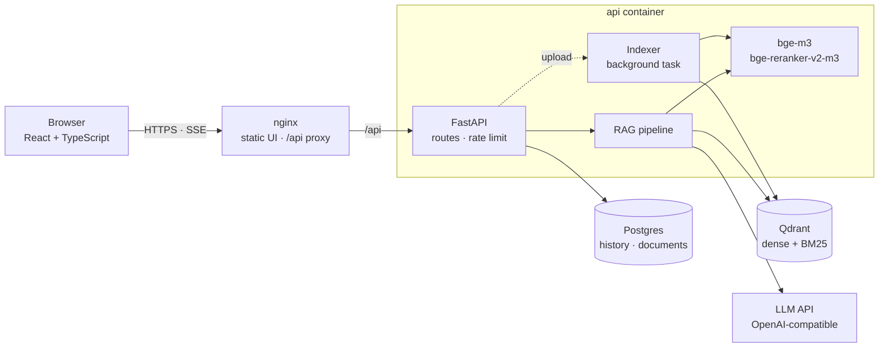
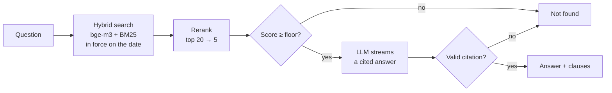

# grounded-rag

[](https://github.com/HoangThanhMan/grounded-rag/actions/workflows/ci.yml)

Vietnamese labour-law Q&A that cites the clause behind every answer and refuses when the law is silent.


## Table of contents

- [About](#about)
- [Architecture](#architecture)
- [Getting started](#getting-started)
- [Usage](#usage)
- [Configuration](#configuration)
- [Evaluation](#evaluation)
- [Development](#development)
- [Project status](#project-status)
- [Limitations](#limitations)
- [Acknowledgements](#acknowledgements)
- [License](#license)

## About

When an answer about the law sounds right but is invented, it does more harm
than no answer at all. This app answers questions about Vietnamese labour and
social-insurance law in one of two ways: with an answer tied to the exact
clause it comes from, or with a plain "not found".

- **Cited answers.** An answer is shown only if it cites a clause that was
  retrieved for it. Click a citation and the clause opens with its law and
  effective date.
- **Refusal over invention.** If no clause is relevant enough, the LLM is not
  called at all. The same applies when the answer cites nothing it was given.
- **The law as of a date.** Only clauses in force on the chosen day are
  searched, so the 2014 and 2024 Social Insurance Laws never mix.
- **A complete web app.** Answers stream in, and follow-up questions work. Each
  browser keeps its own history, with no sign-up, and can rate answers 👍/👎.
  An admin can upload new laws.

The library holds Bộ luật Lao động 2019 and Luật Bảo hiểm xã hội 2014 and
2024, split into 1,375 clause-level chunks.

## Architecture



| Component | Technology | Role |
|---|---|---|
| Web | React, Vite, nginx | Serves the UI and proxies `/api` from the same origin |
| API | FastAPI, SQLAlchemy (async), Alembic | Streams answers over server-sent events, stores history, indexes uploads |
| Models | bge-m3, bge-reranker-v2-m3 on CPU | Embedding and reranking, run in a thread pool off the event loop |
| Storage | Postgres, Qdrant | Conversations and the document library; clause vectors with dates |
| LLM | Any OpenAI-compatible API | Gemini, Groq, Ollama or vLLM, with optional fallback models |

### How a question is answered



A follow-up is first rewritten as a standalone question. Dense and BM25 results
are fused with reciprocal rank fusion, and a cross-encoder keeps the best five.
If the answer fails the citation check although retrieval found good sources,
a stronger model can try once more. The whole pipeline is one file,
[`service.py`](backend/src/grounded_rag/service.py).

Laws are chunked along their own structure, one chunk per khoản (clause).
Each chunk carries its law, chapter and section. Without that context,
Điều 95 of the 2024 law, which pays 2,000,000 đồng per child under *voluntary*
insurance only, reads like every worker's entitlement.

## Getting started

### Requirements

- Docker with Compose
- To use the real models: about 6 GB of RAM and 7 GB of disk
- An API key for an OpenAI-compatible LLM; Gemini and Groq have free tiers

### Run with Docker

```bash
git clone https://github.com/HoangThanhMan/grounded-rag.git
cd grounded-rag
cp .env.example .env    # uncomment one LLM preset and set ADMIN_API_KEY
docker compose up --build -d
```

Open http://localhost:8080. The first start downloads the models and indexes
the three laws, which takes a few minutes on CPU. Follow it with
`docker compose logs -f api`.

Without an LLM key the app runs in mock mode: every page works, but the
answers are canned. This is enough to look around the UI.

## Usage

- **Ask.** Type a question in Vietnamese. Pick a date to read the law as of
  that day.
- **Check the source.** Click a citation number to open the clause beside the
  answer.
- **Manage documents.** On the *Văn bản* page, enter the admin key to upload a
  `.md` or `.pdf` law and watch it being indexed.

The same works over HTTP:

```bash
curl -N -c jar -b jar localhost:8080/api/chat \
  -H 'content-type: application/json' \
  -d '{"question": "Nghỉ việc phải báo trước bao nhiêu ngày?"}'
```

The response is a stream of events: `meta`, then `sources`, then `token`
repeated, then `done` (or `error`). The cookie jar keeps the conversation for
follow-up questions.

| Endpoint | Description |
|---|---|
| `POST /api/chat` | Ask a question; server-sent events |
| `GET /api/conversations`, `GET · DELETE /api/conversations/{id}` | This browser's history |
| `PUT /api/messages/{id}/feedback` | Rate an answer up or down |
| `GET /api/documents`, `POST · DELETE` (admin) | The law library |
| `GET /healthz`, `GET /readyz` | Liveness and readiness |

Interactive API docs: http://localhost:8000/docs.

## Configuration

Settings come from `.env`. All of them are listed with defaults in
[`.env.example`](.env.example). The ones you are most likely to change:

| Variable | Purpose |
|---|---|
| `LLM_BASE_URL`, `LLM_API_KEY`, `LLM_MODEL` | The model that answers |
| `LLM_FALLBACKS`, `LLM_ESCALATION` | Backup models, and a stronger model for a second try |
| `ADMIN_API_KEY` | Enables document upload and delete |
| `RETRIEVAL_MIN_SCORE` | The rerank score below which the app refuses (default `0.30`) |
| `RATE_LIMIT_PER_MINUTE` | Questions per client per minute (default `20`) |
| `POSTGRES_PASSWORD` | Set it before the first start |

For a public deployment, also put TLS in front of port 8080 and set
`COOKIE_SECURE=true`. If the proxy runs on the same host, set `WEB_BIND` and
`REAL_IP_FROM` as described in `.env.example`.

## Evaluation

The evaluation asks whether the app retrieves and cites the right clause, and
whether it refuses when the law has no answer. It uses 100 test questions:
60 answerable and 40 that are out of scope, rest on a false premise, or ask for
a detail the law does not give. A further 15 hard questions are kept apart;
they need several clauses, contain a trap between insurance schemes, or
compare law versions. Scoring is automatic.

These are the results of the first run, at commit `b03a054`:

| Gold clause in top 5 | Correct answer | Refuses when the law is silent | Refuses an answerable question |
|---|---|---|---|
| 0.98 (59/60) | 0.85 (51/60) | 0.95 (38/40) | 0.02 (1/60) |

The method, the scoring rules and their limits are in
[`eval/README.md`](eval/README.md).

## Development

```bash
make install                 # backend with models, frontend packages
docker compose up -d qdrant
make dev-api                 # API on :8000 with reload (SQLite)
make dev-web                 # UI on :5173, proxying /api
make test                    # backend and frontend tests
make lint
```

CI runs the backend tests on both SQLite and Postgres, and the frontend
typecheck, tests and build.

```
backend/      FastAPI app, Alembic migrations, tests
frontend/     React app, nginx config
eval/         questions, runner, scoring, results
data/corpus/  the three laws, with YAML front matter
scripts/      rebuild the corpus from Công báo
```

## Project status

The app is complete and runs end to end with real models. Work in progress:

- Rerun the evaluation on the current code, which adds chunk context, and
  compare it with the naive baseline and with the stronger-model cascade.
- Follow cross-references between articles, such as "khoản 1 Điều 139 của Bộ
  luật này".
- Answer questions that compare two versions of a law.

## Limitations

- **Three laws only.** The decrees and circulars that detail them (nghị định,
  thông tư) are not in the library.
- **Article-level citations for the 2014 law.** The source copy lost its clause
  numbers, so that law is cited by Điều only.
- **CPU latency.** The first token usually arrives after 10–20 seconds.
- **Not legal advice.** This is a lookup tool, and the UI says so.

## Acknowledgements

- Legal texts come from the official gazette (Công báo). The 2014 Social
  Insurance Law comes from a third-party copy, checked against the gazette
  scan where noted in its front matter.
- Some evaluation questions are adapted from
  [TVPL-Retrieval-VN](https://huggingface.co/datasets/GreenNode/TVPL-Retrieval-VN)
  (CC-BY-SA-4.0) and from the Zalo AI Legal Text Retrieval dataset (MIT). See
  [`eval/LABELING.md`](eval/LABELING.md).

## License

No license has been chosen yet. Evaluation questions adapted from
TVPL-Retrieval-VN remain under CC-BY-SA-4.0.
