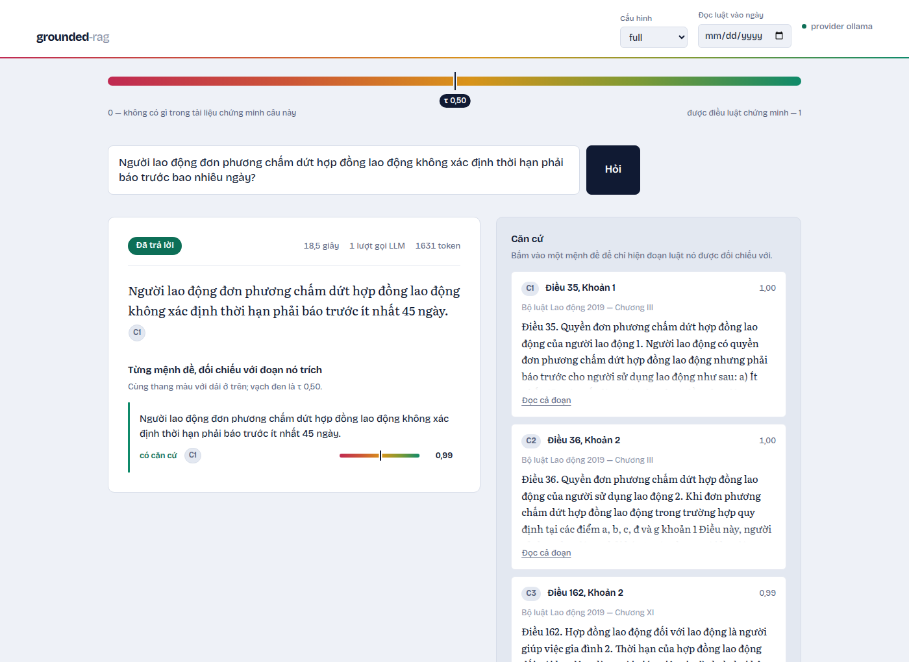
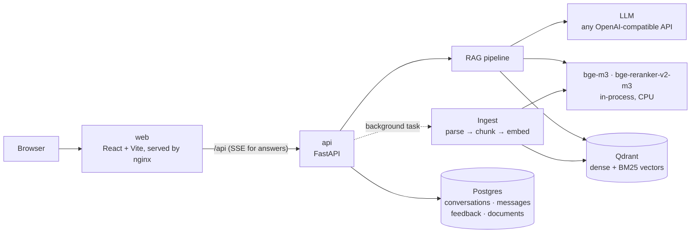
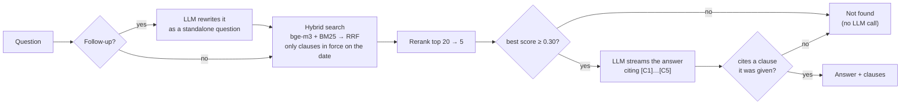

# grounded-rag

[](https://github.com/HoangThanhMan/grounded-rag/actions/workflows/ci.yml)

**Ask about Vietnamese labour and social-insurance law; every answer cites the clause it rests on, and the app says so when the law has no answer.**



## What it does

- **Cites the clause.** An answer is shown only if it cites a clause it was
  given; click a citation and the clause opens beside the answer with its law
  and effective date.
- **Refuses instead of guessing.** If nothing in the library is relevant enough,
  or the model cannot tie its answer to a clause, the user sees "not found"
  rather than a plausible invention.
- **Reads the law as of a date.** The 2014 and 2024 Social Insurance Laws are
  both in the library. Ask "as of 01/01/2025" and only clauses in force that day
  are searched.
- **Is a whole app.** Streaming answers, follow-up questions, a private
  conversation history per browser (an anonymous cookie, no sign-up),
  👍/👎 feedback, and a document library where an admin uploads a law
  (`.md` or `.pdf`) and watches it being indexed.

Corpus: Bộ luật Lao động 2019, Luật Bảo hiểm xã hội 2014 and 2024, from the
official gazette (Công báo).

## Architecture



Four containers in [`docker-compose.yml`](docker-compose.yml). nginx serves the
built UI and forwards `/api` to FastAPI, so the browser sees one origin. FastAPI
answers questions, stores every conversation in Postgres (SQLAlchemy +
Alembic), and indexes uploaded laws after the upload request has returned. The
embedding and reranking models run inside the API process on a bounded thread
pool, so they never block the event loop.

### How a question is answered



The pipeline is one file, [`service.py`](backend/src/grounded_rag/service.py),
top to bottom. Laws are chunked along their own structure, one chunk per
*khoản* (clause) carrying its *Điều* (article) heading, so a citation lands on
a real clause ([`chunkers.py`](backend/src/grounded_rag/ingest/chunkers.py)).

## Evaluation

One question, measured once: **compared with a naive RAG, does the app cite
the right clause, and does it refuse when the law says nothing?** 100 test
questions, 60 answerable and 40 not. The same LLM and prompt for both systems.
Scoring is automatic. Method and limits: [`eval/README.md`](eval/README.md).

> Results pending: run `make ingest && make eval` (needs an LLM key in `.env`)
> and the table from `eval/results/summary.md` goes here.

## Run it

```bash
cp .env.example .env          # optional: pick an LLM preset (Groq, Gemini, Ollama)
docker compose up --build     # → http://localhost:8080
```

Without a key the app runs on the `mock` provider: every page works and
answers are canned echoes of the top clause. The first start indexes the three
laws in `data/corpus/`; with real models that downloads bge-m3 and the reranker
(~4.6 GB) and takes a few minutes on CPU. Set `ADMIN_API_KEY` in `.env` to
upload or delete documents.

Before putting it on a server:

- Set `POSTGRES_PASSWORD` and `ADMIN_API_KEY` in `.env` **before the first
  `up`**. Postgres keeps the password it was created with, so changing it later
  means changing it inside the database too.
- Put TLS in front of port 8080, then set `COOKIE_SECURE=true`, and set
  `REAL_IP_FROM` to the proxy's address so the rate limit sees real clients
  (for a proxy on the same host, the Docker network: `172.16.0.0/12`).
- Give the machine ~6 GB of RAM for the two models.

Every setting, with its default, is in [`.env.example`](.env.example).

For development: `make dev-api` and `make dev-web` (Vite on :5173 with a proxy
to the API), `make test`, `make lint`.

## API

| Method | Path | |
|---|---|---|
| POST | `/api/chat` | Answer a question. Server-sent events: `meta` → `sources` → `token`… → `done` (or `error`) |
| GET | `/api/conversations` · `/api/conversations/{id}` | History, with sources and feedback |
| DELETE | `/api/conversations/{id}` | |
| PUT | `/api/messages/{id}/feedback` | `{"rating": "up" \| "down"}` |
| GET | `/api/documents` | The library and each law's indexing status |
| POST · DELETE | `/api/documents` · `/api/documents/{id}` | Admin (`X-API-Key`): upload a `.md`/`.pdf`, remove a law |
| GET | `/healthz` · `/readyz` | Alive · Qdrant and Postgres reachable |
| GET | `/metrics` | Prometheus; on the API port (127.0.0.1:8000) only, not through nginx |

```bash
curl -N localhost:8080/api/chat -H 'content-type: application/json' \
  -d '{"question": "Nghỉ việc phải báo trước bao nhiêu ngày?"}'
```

Every error has one shape, `{"error": {"code", "message", "request_id"}}`, and
the request id matches the `X-Request-ID` header and the request's JSON log
line. `/api/chat` is rate-limited per client (20 a minute by default). The
interactive docs are at `localhost:8000/docs`.

## Design decisions

- **Chunk by clause, not by token count.** A legal answer is a clause; a
  fixed-size window splits clauses and merges neighbours, and its citation
  points at neither.
- **Hybrid search and a reranker.** People type the law's own words ("đơn
  phương chấm dứt", "Điều 35"), which BM25 matches exactly and embeddings blur;
  the cross-encoder then orders the merged list.
- **A retrieval floor and mandatory citations instead of an NLI verifier.** An
  earlier version checked every sentence against its clause with an NLI model.
  Measured against hand-graded answers, it caught none of the errors the
  generator actually made and doubled p95 latency. The cheap checks did the
  work, so they stayed and the model went. That research is kept at the tag
  [`research-v0`](https://github.com/HoangThanhMan/grounded-rag/tree/research-v0).
- **Background tasks, not a job queue.** Uploads are rare, so
  `BackgroundTasks` plus a status column is enough. At startup the app
  re-indexes any document the library lists but the index lacks - an upload
  cut off by a restart, or a wiped Qdrant volume - from the file it keeps.
- **No agent framework.** Five steps and one branch read better as one plain
  function.

## Limitations

- Three laws. Decrees and circulars that detail them (nghị định, thông tư)
  are not in the library, so some practical questions are refused.
- The models run on the API's CPU: the reranker alone takes 5–15 seconds
  before the first token, and indexing a large upload slows answers down
  meanwhile.
- One API replica: the rate limiter and the indexer live in its process.
- A lookup tool, not legal advice. The UI says so under every question box.

## Layout

```
backend/    FastAPI app (src/grounded_rag), Alembic migrations, tests
frontend/   React + TypeScript UI, nginx config
eval/       the evaluation: questions, runner, results
data/       the corpus (committed) and uploads
scripts/    rebuild the corpus from Công báo
```
