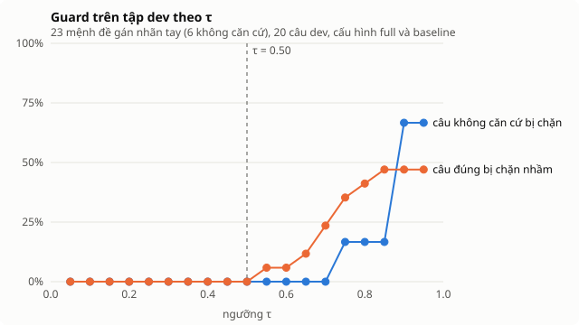

# 06 — Thiết kế groundedness guard

Đây là phần lõi của dự án. Mọi thứ khác là RAG bình thường.

## Ý tưởng

Một câu trả lời RAG đúng là câu trả lời mà **mọi khẳng định trong đó đều suy ra
được từ đoạn tài liệu mà nó viện dẫn**. Đó chính là định nghĩa của quan hệ
*entailment* trong NLI. Vậy nên bài toán "phát hiện bịa" được đưa về một bài
toán NLI đã có model sẵn.

```
premise    = nội dung đoạn tài liệu được trích dẫn
hypothesis = mệnh đề trong câu trả lời
score      = P(entailment)
```

## Bốn bước

### 1. Tách mệnh đề — `claim_splitter.py`

Cắt câu trả lời thành từng câu, mỗi câu mang theo mã trích dẫn của nó.

Cái bẫy: tiếng Việt pháp lý có dấu chấm không kết thúc câu — "Điều 35.",
"khoản 1.", "NĐ 145.". Module bảo vệ các token này (không phân biệt hoa thường)
trước khi cắt, rồi khôi phục. Danh sách token nằm ở `_PROTECTED`, phải cập nhật
khi đổi corpus.

Hai cái bẫy nữa, đến từ cách LLM viết chứ không phải từ văn bản luật:

- **Trích dẫn đặt sau dấu chấm:** "Câu một. [C1] Câu hai." — nếu cắt thẳng thì
  `[C1]` thuộc về câu hai. Mã trích dẫn được đưa vào trong câu trước khi cắt.
- **Trả lời dạng danh sách:** mỗi dòng là ít nhất một mệnh đề; ký hiệu đầu dòng
  (`1.`, `-`, `•`) bị bỏ; mảnh không có chữ nào không phải là mệnh đề.

Và ba cái bẫy lộ ra khi chạy `qwen2.5:3b` trên 100 câu (2026-09-17):

- **Ngoặc vuông không phải `[C1]`:** model viết `[Điều 105][C1]` — không câu
  nào, chỉ mã — và tự chế `[CR1]`, `[TRẢ LỜI]`. Hai loại đó bị bỏ. Nhưng model
  cũng đặt chính đáp án trong ngoặc, "tối đa là [60 ngày] [C1]": loại này chỉ
  bỏ ngoặc, giữ chữ. Lần đầu sửa đã xóa cả nội dung, biến câu đúng thành "tối
  đa là." — và guard loại nó, đúng như phải làm.
- **Chép lại ô trả lời:** tiền tố "Câu trả lời:" bị bỏ.
- **Dòng dẫn nhập:** "Theo tài liệu:" không có trích dẫn và kết thúc bằng dấu
  hai chấm không phải mệnh đề. Trước đây nó bị tính là `uncited` và đẩy mọi câu
  trả lời dạng danh sách vào vòng sinh lại.

Có unit test riêng cho từng trường hợp (`test_claim_splitter.py`).

### 2. Kiểm chứng — `nli_verifier.py`

Model: `MoritzLaurer/mDeBERTa-v3-base-xnli-multilingual-nli-2mil7`

- Đa ngữ, có tiếng Việt trong tập huấn luyện
- ~280M tham số → chạy được trên CPU
- Cache theo `sha256(premise || hypothesis)`; trong eval, cùng một cặp lặp lại
  rất nhiều nên cache tiết kiệm đáng kể

Mệnh đề trích dẫn nhiều đoạn thì premise là các đoạn nối lại; trích từ ba đoạn
trở lên thì chấm thêm từng cặp, vì ba khoản nối lại dễ vượt 512 token và khoản
bị cắt thường chính là khoản mệnh đề cần.

Hai lớp bọc quanh model, cả hai trong `NLIVerifier.entailment`:

- **Chấm theo từng phần của khoản luật, lấy điểm cao nhất.** Một khoản là tiêu
  đề Điều + câu dẫn + danh sách a), b), c), hoặc vài câu liền nhau. Mệnh đề
  thường chỉ nhắc lại một mục. Đọc cả khoản, model chấm câu đúng "được ký tối đa
  36 tháng" 0.46 — bằng chứng là một dòng giữa những dòng không liên quan. Mỗi
  "view" giữ tiêu đề Điều và câu dẫn của danh sách, để một mục không bao giờ bị
  đọc tách khỏi chủ thể và điều kiện của nó (`premise_views`).
- **Luật con số.** Mọi con số trong mệnh đề phải xuất hiện trong premise ("08"
  và "8" là một số), nếu không điểm là 0 và model không cần chạy. Câu trả lời
  pháp luật *chính là* con số, và NLI chấm "48 giờ → 40 giờ" tới 0.72.

### 2b. Sửa trích dẫn — `policy.py::_recite`

Model nhỏ hay trích `[C1]` cho nội dung của `[C2]`. Khi mệnh đề không được đoạn
nó trích chứng minh, guard thử từng đoạn *khác đã đưa cho model*; nếu một đoạn
đơn lẻ đạt τ, trích dẫn được chuyển sang đoạn đó (`cited_as` giữ nhãn gốc, giao
diện hiển thị). Không có gì ngoài context lọt qua được — mệnh đề vẫn phải được
một đoạn đã truy xuất chứng minh. Mệnh đề không có trích dẫn nào thì không được
sửa: đó vẫn là vi phạm hợp đồng của prompt.

### 3. Chính sách — `policy.py`

| Tình huống | Hành động |
|---|---|
| Mọi mệnh đề `≥ τ` | Trả lời, `status: answered` |
| Có mệnh đề `< τ`, chưa sinh lại | Sinh lại 1 lần kèm phản hồi cụ thể |
| Sinh lại mà model từ chối, lượt đầu có mệnh đề `≥ τ` | Giữ các mệnh đề đã kiểm chứng, `status: partial` |
| Sau sinh lại vẫn còn mệnh đề `< τ`, còn mệnh đề tốt | Bỏ mệnh đề xấu, `status: partial` |
| Không còn mệnh đề nào tốt | Từ chối, `status: abstained`, `abstain_reason: guard` |
| Mệnh đề không có trích dẫn | `verdict: uncited` — luôn bị coi là không có căn cứ |
| Model trả đúng câu từ chối của prompt | `status: abstained`, `abstain_reason: model` — không kiểm chứng, **không sinh lại** |

Dòng cuối quan trọng hơn vẻ ngoài của nó. Câu từ chối không có mã trích dẫn nên
trước đây bị coi là mệnh đề `uncited`: guard sinh lại vô ích, còn baseline bị
tính là "trả lời và bịa" đúng lúc nó từ chối đúng.

Phản hồi khi sinh lại nêu đích danh mệnh đề có vấn đề, không phải lời nhắc
chung chung:

```
Câu trả lời trước có những mệnh đề KHÔNG được tài liệu chứng minh:
- Người lao động được thưởng thêm 10% lương.
Hãy viết lại, chỉ dùng thông tin có trong tài liệu được cung cấp.
```

### 4. Hiệu chỉnh ngưỡng τ

**τ không được chọn bừa.** Quy trình:

1. Tách 20 câu từ tập đánh giá làm tập dev (không dùng lại khi báo cáo)
2. Chạy pipeline, thu điểm entailment của từng mệnh đề
3. Gán nhãn thủ công từng mệnh đề: có căn cứ / không có căn cứ
4. Quét τ từ 0.1 đến 0.9, vẽ precision–recall của guard
5. Chọn τ tại điểm mà `false_abstention` còn dưới 15%

```bash
make calibrate     # = scripts/calibrate_tau.py collect, gán nhãn tay, rồi sweep
```

#### Kết quả 2026-09-17 — τ = 0.50, và guard không tách được lỗi trên dev

20 câu dev (`"split": "dev"`, phân tầng theo loại), trả lời bằng `qwen2.5:3b`
với truy xuất của `full` và của `baseline`, guard tắt để giữ mọi mệnh đề. 23
mệnh đề, gán nhãn tay bằng cách đọc premise (lượt gán do trợ lý AI làm; lý do của
từng nhãn "không căn cứ" nằm trong `reports/tau-dev-claims.json`). Điểm chấm
bằng verifier hiện tại (`calibrate_tau.py rescore` sau mỗi lần đổi verifier).
Kết quả: `reports/tau-sweep.json`.



| τ | mệnh đề sai bị chặn (6) | mệnh đề đúng bị chặn nhầm (17) |
|---|---|---|
| **0.50** | **0%** | **0%** |
| 0.60 | 0% | 6% |
| 0.65 | 0% | 12% |
| 0.70 | 0% | 24% |
| 0.75 | 17% | 35% |
| 0.90 | 67% | 47% |

**Không có τ nào tách được hai nhóm.** Cả sáu mệnh đề sai được chấm ≥ 0.70:
đảo điều kiện, bỏ điều kiện, đổi chủ thể nam → nữ, lấy nhầm con số của mục bên
cạnh (40 thay vì 30 ngày — cả hai đều có trong khoản), nhầm chế độ, "15 tháng"
thay "15 năm". Muốn chặn được 2/3 số đó phải chặn nhầm gần một nửa số câu đúng.

Vì tỉ lệ bắt lỗi bằng 0 trên cả dải 0.05–0.70, nâng τ trong dải đó chỉ mua thêm
chặn nhầm. τ được chọn là **0.50**: thấp nhất mà probe 24 cặp bên dưới vẫn cho
đúng kết quả như ở 0.60 (không cặp nào rơi vào khoảng 0.50–0.60; dưới 0.30 thì
cặp "khuyến khích → bắt buộc" bắt đầu lọt), và trên dev không chặn nhầm câu nào.
Trước đó τ = 0.60 là con số chọn trước khi có dữ liệu.

Đọc đúng con số này: trên dev, **NLI không bắt được lỗi nào** trong số những
lỗi model thật sự mắc. Phần guard bắt được nằm ở chỗ khác: luật con số, mệnh đề
không trích dẫn, nhãn trích dẫn không tồn tại. Hai mươi ba mệnh đề là mẫu nhỏ;
kết luận "NLI yếu với kiểu lỗi này" khớp với probe, còn con số phần trăm thì
không nên trích riêng.

### Probe NLI trên 24 cặp (2026-09-17)

`make nli-probe` (`--model` để đổi model). Premise là khoản luật thật; bảy cặp
"khoản dài" là câu đúng mà lượt chạy 100 câu đầu tiên đã loại. `raw` = model đọc
cả khoản; `guard` = verifier (view tốt nhất + luật con số). Sai ở τ = 0.60 (ở 0.50 giống hệt):

| Nhóm (số cặp) | mDeBERTa raw | mDeBERTa guard | xlm-roberta-large guard |
|---|---|---|---|
| Câu đúng, khoản ngắn (3) | 0 | 0 | 0 |
| Câu đúng, một mục của khoản dài (7) | 1 | **0** | 1 |
| Đổi con số (4) | 1 | **0** | 0 |
| Con số của mục bên cạnh (2) | 1 | 2 | 2 |
| Phủ định (1) | 0 | 0 | 0 |
| Đổi chủ thể (2) | 1 | 1 | 1 |
| Đổi/bỏ điều kiện, near-miss (5) | 2 | 2 | 4 |
| **Tổng sai** | **6** | **5** | **8** |

View theo mục sửa hết lỗi "chặn nhầm câu đúng"; luật con số sửa hết lỗi đổi số.
View cũng có giá: "con đẻ kết hôn được nghỉ 03 ngày" từ 0.51 lên 0.80, vì đọc
riêng mục "c) ... chết: nghỉ 03 ngày" cạnh câu dẫn thì con số khớp. Hai lớp đó
không chạm được vào nhóm còn lại, và model lớn hơn gấp đôi còn tệ
hơn ở nhóm đó — nên giữ mDeBERTa.

## Guard sai ở đâu

Biết giới hạn của giải pháp mình làm quan trọng ngang việc làm ra nó. Bảng này
là những gì hai phép đo bên trên — hiệu chỉnh τ trên 23 mệnh đề dev và probe 24
cặp — thật sự cho thấy, không phải dự đoán:

| Loại lỗi | Guard xử lý được? | Ghi chú |
|---|---|---|
| Mệnh đề không trích dẫn, hoặc trích nhãn không tồn tại | ✅ | Bắt được mà không cần chạy model nào |
| Con số bị đổi | ✅ | Luật con số, không phải NLI. NLI chấm "48 → 40 giờ/tuần" tới 0.72 |
| Câu đúng diễn đạt lại một mục của khoản dài | ✅ | Chấm theo `premise_views` sửa hết 7/7 cặp trong probe |
| Lấy con số của mục bên cạnh trong cùng khoản | ❌ | Con số *có* trong premise nên luật con số không chặn; NLI cho qua |
| Đổi chủ thể ("người sử dụng lao động" thay "người lao động") | ❌ | NLI thiên về trùng từ vựng. Model lớn gấp đôi cũng không khá hơn |
| Thêm hoặc bỏ điều kiện, near-miss | ❌ | Loại khó nhất trong tập đánh giá, và `xlm-roberta-large` còn tệ hơn |
| Mệnh đề đúng cần suy luận nhiều bước | ❌ | NLI cho `neutral`; tính vào `false_abstention` |

Đọc hàng ❌ cho đúng: trên tập dev, **NLI không bắt được lỗi nào** trong số những
lỗi model thật sự mắc. Phần guard thật sự bảo vệ được nằm ở ba hàng ✅ đầu, và
hai trong ba hàng đó không dùng NLI. Đó là kết luận trung thực của dự án này,
không phải là kết luận nó muốn có.

**Chi phí của guard là `false_abstention`** — từ chối nhầm câu trả lời được. Đây
là chỉ số bắt buộc báo cáo cùng `hallucination_rate`. Một guard chặn 100% câu
bịa bằng cách từ chối mọi thứ là guard vô dụng, và bảng số liệu phải cho thấy
được điều đó.

## Vì sao không dùng LLM để chấm

Xem [ADR-0001](adr/0001-nli-over-llm-judge.md).
