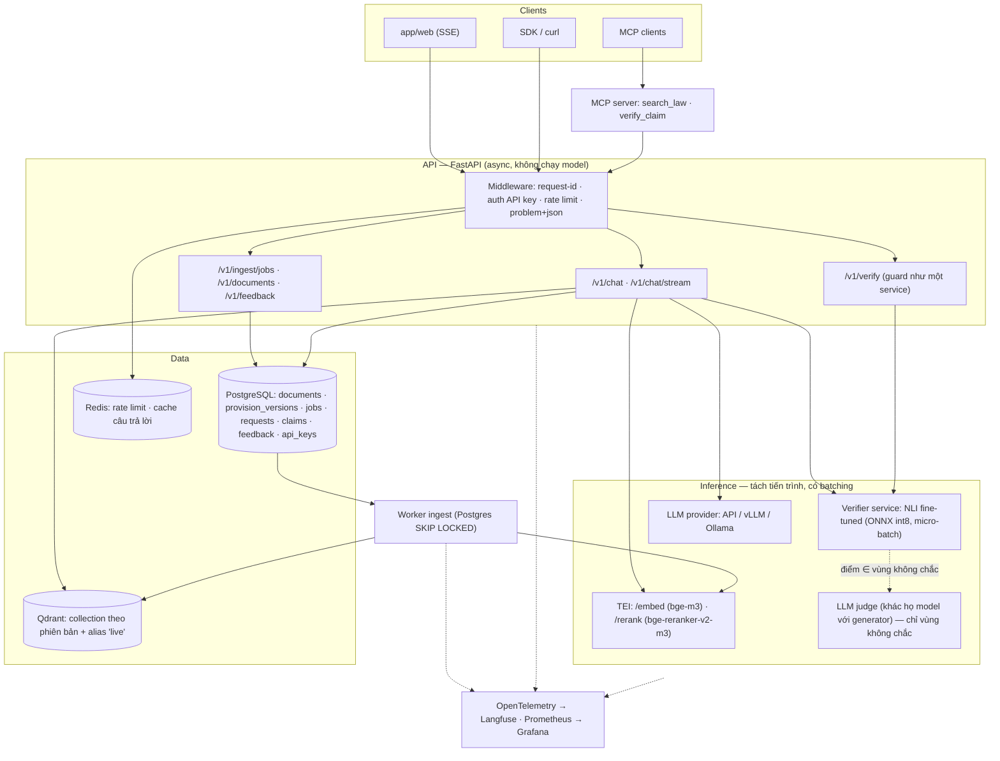
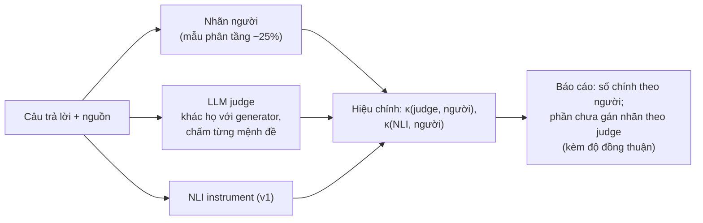
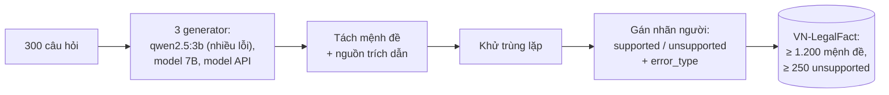
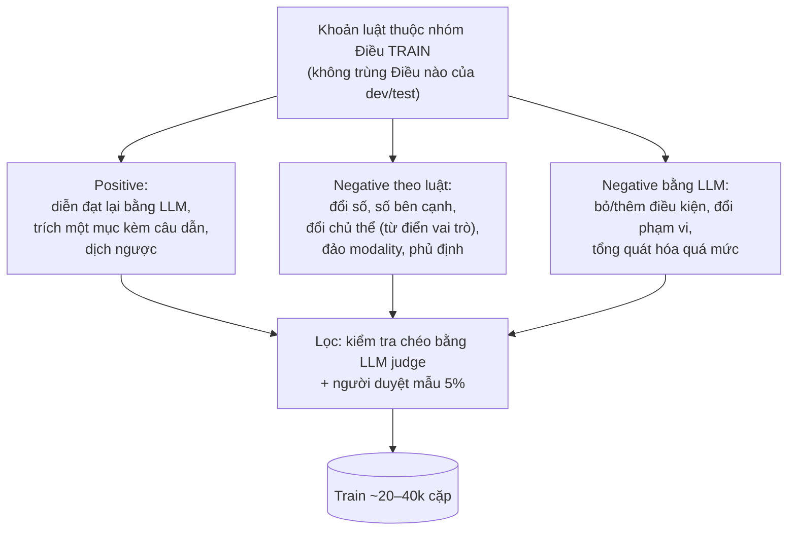
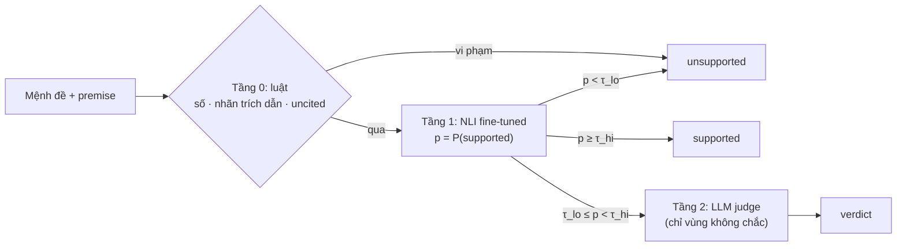
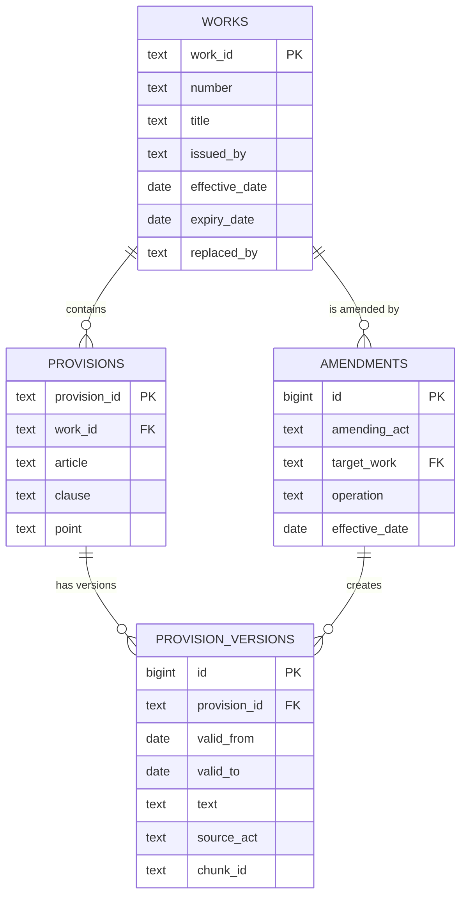
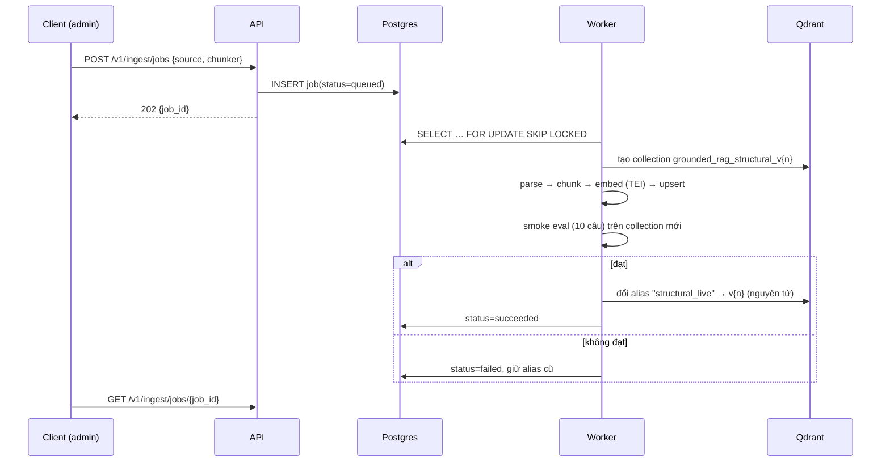
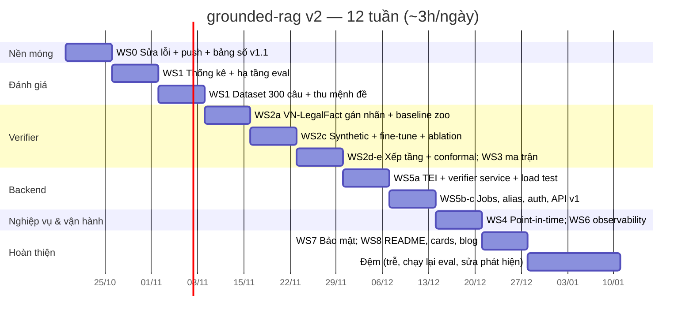

# 11 — Spec nâng cấp grounded-rag v2

| | |
|---|---|
| Trạng thái | **Draft** — chờ duyệt trước khi bắt đầu tuần 1 |
| Ngày | 2026-10-12 |
| Thay thế | Mục "Sau khi xong" của [08](08-roadmap.md); bổ sung [02](02-requirements.md), [06](06-guard-design.md), [07](07-evaluation-plan.md) |
| Thời lượng | 12 tuần (10 tuần việc + 2 tuần đệm), ~3h/ngày, một người |
| Đầu ra cuối | Tag `v2.0.0`, README có bảng số thật kèm khoảng tin cậy, dataset + model công bố trên Hugging Face, 2 bài blog |

---

## Mục lục

1. [Tóm tắt](#1-tóm-tắt)
2. [Hiện trạng — đo được, không phỏng đoán](#2-hiện-trạng--đo-được-không-phỏng-đoán)
3. [Mục tiêu, phi mục tiêu, nguyên tắc](#3-mục-tiêu-phi-mục-tiêu-nguyên-tắc)
4. [Chỉ số thành công & SLO](#4-chỉ-số-thành-công--slo)
5. [Kiến trúc mục tiêu](#5-kiến-trúc-mục-tiêu)
6. [Workstreams](#6-workstreams)
   - [WS0 — Sửa lỗi nghiêm trọng & vệ sinh repo](#ws0--sửa-lỗi-nghiêm-trọng--vệ-sinh-repo)
   - [WS1 — Đánh giá 2.0: thống kê nghiêm túc](#ws1--đánh-giá-20-thống-kê-nghiêm-túc)
   - [WS2 — Verifier 2.0: phần lõi](#ws2--verifier-20-phần-lõi)
   - [WS3 — Chất lượng sinh & truy xuất](#ws3--chất-lượng-sinh--truy-xuất)
   - [WS4 — Mô hình hóa pháp luật theo thời điểm](#ws4--mô-hình-hóa-pháp-luật-theo-thời-điểm)
   - [WS5 — Serving & backend](#ws5--serving--backend)
   - [WS6 — Observability & LLMOps](#ws6--observability--llmops)
   - [WS7 — An toàn & bảo mật](#ws7--an-toàn--bảo-mật)
   - [WS8 — Đóng gói & kể chuyện](#ws8--đóng-gói--kể-chuyện)
7. [Đặc tả API v1](#7-đặc-tả-api-v1)
8. [Đặc tả dữ liệu](#8-đặc-tả-dữ-liệu)
9. [Kế hoạch 12 tuần](#9-kế-hoạch-12-tuần)
10. [Ma trận năng lực — dự án chứng minh điều gì](#10-ma-trận-năng-lực--dự-án-chứng-minh-điều-gì)
11. [Ngân sách](#11-ngân-sách)
12. [Rủi ro](#12-rủi-ro)
13. [ADR cần viết](#13-adr-cần-viết)
14. [Câu hỏi mở](#14-câu-hỏi-mở)
15. [Tài liệu tham khảo](#15-tài-liệu-tham-khảo)

---

## 1. Tóm tắt

v1 đặt đúng câu hỏi: *làm sao biết một câu trả lời RAG có đáng tin không?* Và nó
trả lời trung thực rằng guard NLI có sẵn **không bắt được lỗi thật** của
generator. v2 biến phát hiện đó thành đóng góp:

1. **Xây dữ liệu để đo đúng** — một tập mệnh đề pháp luật tiếng Việt có nhãn
   người (*VN-LegalFact*), thu từ lỗi tự nhiên của các generator chứ không chỉ
   từ ví dụ tự chế. Tách được công cụ đo khỏi guard, chấm dứt vòng lặp "NLI
   chấm NLI".
2. **Sửa guard bằng phương pháp có cơ sở** — sinh hard negative có định hướng
   theo đúng các kiểu lỗi probe đã tìm ra (kiểu FactCC/MiniCheck), fine-tune
   verifier, xếp tầng *luật → NLI → LLM judge* chỉ cho vùng điểm không chắc,
   chọn ngưỡng bằng conformal calibration thay vì nhìn đường cong.
3. **Báo cáo như một bài nghiên cứu** — tập test 240+ câu, khoảng tin cậy
   bootstrap, kiểm định cặp giữa các cấu hình, đường cong rủi ro–độ phủ.
4. **Đưa lên mức production** — inference không chặn event loop, ingest bất
   đồng bộ, reindex không downtime, auth và rate limit, Postgres, tracing, load
   test có SLO.
5. **Hiểu đúng lĩnh vực** — pháp luật đọc *theo thời điểm*, ở cấp từng khoản
   (văn bản sửa đổi, thay thế), không phải cấp cả văn bản.

Mọi mục tiêu số bên dưới là **giả thuyết cần đo**. Không đạt thì báo cáo là
phát hiện, tuyệt đối không chỉnh số — giữ đúng nguyên tắc của v1.

---

## 2. Hiện trạng — đo được, không phỏng đoán

### 2.1 Số liệu gần nhất

Lượt chạy đầy đủ `reports/2026-09-15/full.json` — cấu hình `full`, 100 câu,
`qwen2.5:3b-instruct-q4_K_M` qua Ollama trên CPU:

| Chỉ số | Giá trị | Yêu cầu v1 | Đánh giá |
|---|---|---|---|
| hallucination_rate | 0.00 | < 0.10 (N2) | Đạt, nhưng xem dòng dưới |
| **false_abstention** | **0.78** | < 0.15 (N3) | Hệ thống "an toàn" vì gần như không trả lời |
| correct_abstention | 1.00 | — | |
| retrieval_recall | 0.92 | — | Truy xuất không phải nút thắt ([09](09-runbook.md)) |
| citation_precision | 0.88 | — | |
| **latency p95** | **32,9 s** | < 6 s (N1) | Reranker + NLI trên CPU |
| Lớp từ chối câu không trả lời được | floor 0.475 · model 0.50 · guard 0.025 | — | Guard gần như không đóng góp |

Phát hiện trên dev ([06](06-guard-design.md)): trên 23 mệnh đề gán nhãn tay,
**không ngưỡng τ nào tách được mệnh đề đúng khỏi mệnh đề sai**. Cả 6 mệnh đề
sai đều đạt ≥ 0.70. Probe 24 cặp xác nhận các kiểu lỗi lọt qua: đổi chủ thể,
bỏ điều kiện, lấy số của mục bên cạnh.

### 2.2 Lỗi kỹ thuật đã kiểm chứng (2026-10-12)

| # | Lỗi | Bằng chứng | Mức |
|---|---|---|---|
| B1 | **Model CPU chạy đồng bộ trong handler async** → mọi request chạy tuần tự, `/healthz` bị chặn | Thay reranker mock bằng `sleep(1s)`, gửi 3 `/chat` song song: tổng 3,12s, `/healthz` gửi lúc t=0,1s phải đợi tới **t=3,12s**. Vị trí: `retrieval/corrective.py:65,89`, `service.py:138` | Cao |
| B2 | `POST /ingest` không xác thực, nhận **đường dẫn tùy ý** (`api/schemas.py:23`), `recreate` xóa index | Đọc code: `iter_corpus` duyệt `rglob` trên bất kỳ thư mục nào server đọc được | Cao |
| B3 | Provider `anthropic` luôn gửi `temperature` (`llm_client.py:197`) → model Claude hiện hành trả 400 với giá trị không mặc định | Tài liệu API hiện hành. Test chỉ dùng transport giả nên không phát hiện | Trung bình |
| B4 | Cache NLI là `dict` không giới hạn (`nli_verifier.py:99`) → rò bộ nhớ khi server chạy lâu | Đọc code | Thấp |
| B5 | Mỗi lời gọi LLM tạo `httpx.AsyncClient` mới (`llm_client.py:257`) → không tái dùng kết nối | Đọc code | Thấp |
| B6 | Ingest chỉ thêm chunk mới: khoản đã sửa vẫn nằm trong index nếu không `--recreate` | `store.py:141-177` | Trung bình (sai nghiệp vụ) |
| B7 | Hiệu lực chỉ áp ở cấp **văn bản**, không ở cấp khoản | `types.py` `Chunk.in_force` lấy ngày từ `DocMeta` | Trung bình (sai nghiệp vụ) |
| B8 | Docker chạy bằng root, không có HEALTHCHECK, `ollama:latest` không pin; local Python 3.14, CI và Docker 3.12 | `Dockerfile`, `docker-compose.yml` | Thấp |
| B9 | Repo chưa có remote, chưa có CI badge, bảng Results còn trống | `git remote -v` rỗng; README | Cao (không ai xem được) |

### 2.3 Điều v1 làm tốt — giữ nguyên

Cùng một công cụ đo cho mọi cấu hình, `check-dataset` trong CI, tách dev/test
trước khi hiệu chỉnh τ, ADR cho mọi quyết định có phương án thay thế, mục
Limitations viết từ số đo, provider `mock` chạy đầu-cuối không cần API key.
v2 **xây tiếp trên các nguyên tắc này**, không viết lại.

---

## 3. Mục tiêu, phi mục tiêu, nguyên tắc

### 3.1 Mục tiêu

| ID | Mục tiêu |
|---|---|
| G1 | Guard có giá trị đo được: bắt được phần lớn mệnh đề sai mà không chặn nhầm nhiều mệnh đề đúng, trên dữ liệu **chưa từng dùng để huấn luyện hay hiệu chỉnh** |
| G2 | Hệ thống hữu ích: trả lời phần lớn câu trả lời được, với generator ở mức sản phẩm |
| G3 | Mọi con số trong README có khoảng tin cậy và tái lập được bằng một lệnh |
| G4 | Serving đạt mức production: không chặn event loop, có SLO, load test, auth, job bất đồng bộ, reindex không downtime |
| G5 | Đúng nghiệp vụ: đọc luật theo thời điểm ở cấp khoản |
| G6 | Đóng góp ra ngoài: dataset và model công bố công khai, guard dùng được như một service độc lập |

### 3.2 Phi mục tiêu (cố tình không làm)

- Multi-tenant, quản lý người dùng, SSO — API key theo client là đủ.
- Kubernetes, autoscaling — Docker Compose + load test trên một máy.
- Agent tự do / framework điều phối — giữ vòng corrective có trần ([ADR-0005](adr/0005-corrective-retrieval-loop.md)).
- Fine-tune generator ([ADR-0007](adr/0007-no-generator-fine-tuning.md) vẫn đúng).
- Mở rộng ra lĩnh vực ngoài lao động / bảo hiểm xã hội — **sâu hơn, không rộng hơn**.
- Frontend mới — giữ `app/web/`, chỉ thêm sự kiện tiến độ.

### 3.3 Nguyên tắc

1. **Đo trước, sửa sau.** Mỗi thay đổi lõi đi kèm một dòng trong bảng ablation.
2. **Không rò rỉ dữ liệu.** Dữ liệu huấn luyện verifier, dữ liệu hiệu chỉnh τ và
   tập test tách nhau theo **Điều luật** (group split), không chỉ theo câu hỏi.
3. **Công cụ đo độc lập với thứ được đo.** Sự thật gốc là nhãn người; LLM judge
   và NLI chỉ là công cụ phụ đã được hiệu chỉnh với nhãn người.
4. **Rẻ trước.** Luật tất định → model nhỏ → model lớn, mỗi tầng chỉ chạy khi
   tầng trước không chắc chắn.
5. **Mỗi quyết định có phương án thay thế → một ADR.**

---

## 4. Chỉ số thành công & SLO

### 4.1 Định nghĩa chỉ số (bổ sung cho [07](07-evaluation-plan.md))

**Cấp câu trả lời**

| Chỉ số | Định nghĩa |
|---|---|
| Coverage | Tỉ lệ câu trả lời được mà hệ thống trả lời (`answered` hoặc `partial`) = 1 − false_abstention |
| Hallucination rate | Trong các câu đã trả lời, tỉ lệ câu có ≥ 1 mệnh đề **không được chứng minh theo nhãn người** (nhãn người trên mẫu, LLM judge đã hiệu chỉnh trên phần còn lại) |
| Correct abstention | Tỉ lệ câu không trả lời được mà hệ thống từ chối |
| AURC | Diện tích dưới đường rủi ro–độ phủ khi quét ngưỡng guard: rủi ro = hallucination rate trên phần được trả lời, độ phủ = coverage. Thấp hơn = tốt hơn |

**Cấp mệnh đề (verifier)**

| Chỉ số | Định nghĩa |
|---|---|
| Catch rate | Recall trên mệnh đề sai: tỉ lệ mệnh đề sai bị guard chặn |
| False-block rate | Tỉ lệ mệnh đề đúng bị guard chặn |
| AUROC / AUPRC | Khả năng xếp hạng của điểm verifier, độc lập ngưỡng |
| ECE | Expected Calibration Error của P(supported) |

**Hệ thống:** p50/p95/p99 latency theo từng bước, TTFT của sự kiện SSE đầu
tiên, throughput bão hòa, chi phí USD/1.000 câu, số lời gọi LLM/câu.

### 4.2 Mục tiêu v2 (giả thuyết, đo trên tập test)

| Hạng mục | Mục tiêu | Ghi chú |
|---|---|---|
| Coverage (generator sản phẩm) | ≥ 0.85 | Tương đương false_abstention ≤ 0.15 (N3) |
| Hallucination rate | ≤ 0.05, cận trên CI 95% ≤ 0.08 | Nhãn người |
| Correct abstention | ≥ 0.90 | |
| Verifier — catch rate | ≥ 0.70 khi false-block ≤ 0.10 | Trên phần test của VN-LegalFact, chia theo Điều |
| Verifier — AUROC | ≥ 0.85 và cao hơn baseline mDeBERTa có ý nghĩa thống kê | Baseline đo ở tuần 4 |
| Conformal | Tỉ lệ mệnh đề sai lọt qua thực tế ≤ α + 0.03 với α = 0.10 | Trên tập test độc lập với tập calibration |
| p95 end-to-end, profile GPU | ≤ 6 s (N1) | Generator API hoặc vLLM, verifier/rerank trên GPU |
| p95 end-to-end, profile CPU | Báo cáo, mục tiêu ≤ 12 s | Từ 32,9 s |
| `/healthz` p99 khi đang tải | < 50 ms | Chứng minh B1 đã được sửa |
| Lỗi 5xx khi tải ở mức SLO | < 0.5% | k6 |

### 4.3 Vì sao cần ≥ 240 câu test

Khoảng tin cậy 95% của một tỉ lệ p ≈ 0.15 xấp xỉ ±1.96·√(p(1−p)/n):

| n câu test | Nửa độ rộng CI |
|---|---|
| 80 (v1) | ±0.078 |
| 240 (v2) | ±0.045 |

Với 80 câu, false_abstention 0.12 và 0.18 không phân biệt được. Không thể kết
luận "cấu hình A tốt hơn B" khi chênh lệch nhỏ hơn độ rộng này.

---

## 5. Kiến trúc mục tiêu



**Thay đổi so với v1** ([03](03-architecture.md)):

| v1 | v2 | Lý do |
|---|---|---|
| Model nạp trong tiến trình API, gọi đồng bộ | TEI + verifier service riêng; API chỉ còn I/O async | Sửa B1; batching qua nhiều request; scale độc lập |
| Ingest đồng bộ qua HTTP | Job trong Postgres, worker riêng, API trả `202` | Ingest mất vài phút; phải sống qua restart |
| Một collection, upsert thêm vào | Collection theo phiên bản + alias `live`, đổi alias nguyên tử | Reindex không downtime, rollback được (B6) |
| Hiệu lực cấp văn bản | `provision_versions` cấp khoản | B7 |
| Không có DB | PostgreSQL | Log truy vấn, feedback, job, nguồn dữ liệu cho eval mới |
| Guard gắn chặt vào RAG | `/v1/verify` dùng được độc lập + MCP tool | Guard thành sản phẩm tái sử dụng |

---

## 6. Workstreams

Mỗi workstream ghi: **vấn đề → thiết kế → tiêu chí chấp nhận → sản phẩm**.
Ưu tiên theo MoSCoW: **M** = must, **S** = should, **C** = could.

### WS0 — Sửa lỗi nghiêm trọng & vệ sinh repo

**Ưu tiên M · Tuần 1 · ~18h**

| Việc | Thiết kế | Chấp nhận |
|---|---|---|
| B9 Remote + CI | Push lên GitHub, badge CI, description, topics | CI xanh trên `main` |
| B1 Event loop | Bước tạm (trước WS5): bọc `search`/`verify_claims` bằng `asyncio.to_thread`, giới hạn đồng thời bằng `asyncio.Semaphore(N)` (N = số luồng torch hợp lý), đặt `torch.set_num_threads` | Test hồi quy: probe ở 2.2 cho `/healthz` < 50 ms khi đang có 3 `/chat` |
| B2 Ingest an toàn | `source` phải nằm dưới `DATA_ROOT` (resolve + `is_relative_to`); `/ingest` yêu cầu API key admin; `recreate` chỉ cho phép qua CLI | Test: `"/etc"` → 400, `"../.."` → 400, thiếu key → 401 |
| B3 Anthropic | Chỉ gửi `temperature` khi được cấu hình rõ ràng; thêm test hợp đồng với body thật | Test khẳng định body không có `temperature` mặc định |
| B4, B5 | `functools.lru_cache`/LRU giới hạn kích thước; một `httpx.AsyncClient` dùng chung, đóng trong lifespan | Test kích thước cache |
| B8 | User non-root, `HEALTHCHECK`, pin image, thống nhất Python 3.12 (`.python-version`, `requires-python`) | `docker compose up` sạch |
| Bảng số đầu tiên | Chạy lại 4 cấu hình trên 80 câu test với **generator sản phẩm** (Gemini flash-lite hoặc Claude Haiku), giữ dòng `qwen2.5:3b` làm "profile CPU, model mở" | README có bảng số thật (v1.1), dù chưa có CI |

**Tiêu chí hoàn thành WS0:** người lạ clone repo về, `docker compose up`, đọc
README thấy bảng số thật; mọi lỗi B1–B5, B8, B9 có test chứng minh đã sửa.

---

### WS1 — Đánh giá 2.0: thống kê nghiêm túc

**Ưu tiên M · Tuần 2–3 · ~45h**

#### 1a. Mở rộng tập câu hỏi: 100 → 300

| Thành phần | Số câu | Nguồn |
|---|---|---|
| answerable | 180 | Viết tay + chọn lọc từ các bộ hỏi–đáp pháp luật công khai (VD: bộ Zalo AI Legal Text Retrieval, tập câu hỏi của shared task VLSP 2025) — **viết lại theo corpus của dự án**, kiểm tra license |
| unanswerable: out_of_scope / false_premise / near_miss | 40 / 40 / 40 | Viết tay, giữ ba kiểu của v1 |
| temporal (mới, WS4) | ≥ 20 trong số trên | Câu có đáp án khác nhau theo `as_of` |
| Tag | colloquial, multi_part, numeric, temporal | Giữ tag cũ, thêm tag mới |

- Chia: **dev 60 / test 240**, phân tầng theo `type` và tag.
- **Chia nhóm theo Điều:** câu có gold thuộc cùng một Điều nằm cùng một split,
  để dev không "dạy" τ trên đúng khoản sẽ xuất hiện ở test.
- `LABELING.md` v2: thêm hướng dẫn cho câu temporal và quy tắc chọn gold khi
  nhiều khoản cùng trả lời được.
- **Độ đồng thuận:** 20% câu (60 câu) được gán nhãn lại độc lập — bởi người thứ
  hai (ưu tiên người học luật), hoặc tự gán lại "mù" sau ≥ 10 ngày nếu không có
  người. Báo cáo Cohen's κ; mục tiêu κ ≥ 0.7. Ghi rõ đó là intra- hay
  inter-annotator.

#### 1b. Thống kê

| Kỹ thuật | Dùng để |
|---|---|
| **Bootstrap CI** (10.000 lần lấy mẫu lại theo câu hỏi) | CI 95% cho mọi chỉ số tỉ lệ và p95 latency |
| **Paired bootstrap / McNemar** | So sánh hai cấu hình trên **cùng** câu hỏi: kết luận "full tốt hơn threshold" chỉ khi p < 0.05 |
| **Đường cong rủi ro–độ phủ + AURC** | Quét τ và floor, vẽ trade-off thay vì báo một điểm duy nhất |
| Lặp lại 3 lần với generator có nhiệt độ > 0 | Báo cáo trung bình ± độ lệch, đo độ ổn định |

```python
# eval/stats.py — phác thảo
def bootstrap_ci(values: list[float], n: int = 10_000, alpha: float = 0.05, seed: int = 0):
    rng = np.random.default_rng(seed)
    arr = np.asarray(values)
    stats = rng.choice(arr, size=(n, len(arr)), replace=True).mean(axis=1)
    return arr.mean(), np.quantile(stats, alpha / 2), np.quantile(stats, 1 - alpha / 2)

def paired_bootstrap_diff(a: list[float], b: list[float], n: int = 10_000, seed: int = 0):
    """a, b: kết quả từng câu (0/1) của hai cấu hình trên CÙNG danh sách câu."""
    rng = np.random.default_rng(seed)
    d = np.asarray(a) - np.asarray(b)
    idx = rng.integers(0, len(d), size=(n, len(d)))
    boots = d[idx].mean(axis=1)
    return d.mean(), np.quantile(boots, [0.025, 0.975]), (boots <= 0).mean()  # p một phía
```

#### 1c. Công cụ đo độc lập với guard



- LLM judge chấm theo kiểu claim-level entailment (giống RAGChecker), dùng
  structured output `{verdict, error_type, rationale}`.
- **Judge không bao giờ cùng họ model với generator** của cấu hình đang chấm, để
  tránh thiên vị chính mình.
- NLI instrument của v1 giữ lại làm chỉ số phụ, công bố độ đồng thuận với người.

#### 1d. Hạ tầng eval

- **Cache retrieval theo câu hỏi**, dùng chung cho các cấu hình có cùng chunker
  và tham số retrieval: bỏ lặp lại 3/4 thời gian rerank.
- **Ma trận chạy** `eval/matrix.yaml`: generator × config × seed, xuất một
  report gộp; chạy được từng phần, resume khi lỗi.
- CI: mỗi PR chạy tập mẫu + gate; **nightly** chạy tập test đầy đủ (workflow
  thủ công / theo lịch, dùng secret API key) và lưu report thành artifact.

**Chấp nhận WS1:** `make eval-matrix` sinh bảng có CI 95%, đường rủi ro–độ phủ,
bảng so sánh cặp có p-value; κ được báo cáo; `check-dataset` kiểm cả split
theo Điều.

---

### WS2 — Verifier 2.0: phần lõi

**Ưu tiên M · Tuần 3–6 · ~70h**

Đây là phần chứng minh "hiểu sâu". Câu chuyện là: *đo được guard thất bại →
xây dữ liệu đúng kiểu lỗi → huấn luyện → xếp tầng → hiệu chỉnh có bảo đảm*.

#### 2a. VN-LegalFact — tập mệnh đề có nhãn người



- **Dùng model yếu làm "máy sinh lỗi tự nhiên":** `qwen2.5:3b` mắc đúng loại
  lỗi đời thực, nên giữ nó lại vì giá trị này.
- Bổ sung lỗi khó có chủ đích: lấy mệnh đề đúng, nhờ một LLM viết lại thành
  near-miss theo taxonomy dưới đây, rồi **người duyệt lại** (không dùng nhãn tự
  động làm nhãn thật).
- Schema:

```json
{"id": "f0412", "question_id": "a017", "claim": "Người sử dụng lao động phải báo trước ít nhất 45 ngày.",
 "premise_ref": "bo_luat_lao_dong_2019:Điều 35:1", "premise": "…",
 "label": "unsupported", "error_type": "subject_swap",
 "source": "generator:qwen2.5-3b", "article_group": "BLLĐ:Điều 35", "split": "test"}
```

**Taxonomy lỗi** (mở rộng từ probe 24 cặp):

| error_type | Ví dụ | v1 bắt được? |
|---|---|---|
| `number_swap` | 45 ngày → 30 ngày | ✅ luật con số |
| `neighbor_number` | Lấy số của điểm b) cho điểm a) | ❌ |
| `subject_swap` | người lao động ↔ người sử dụng lao động | ❌ |
| `condition_drop` | Bỏ "đối với hợp đồng không xác định thời hạn" | ❌ |
| `condition_add` | Thêm "trong thời gian thử việc" | ❌ |
| `scope_swap` | Hợp đồng xác định ↔ không xác định thời hạn | Một phần |
| `modality` | "phải" ↔ "được" ↔ "có thể" — **rất quan trọng trong luật** | Chưa đo |
| `negation` | "không phải báo trước" | ✅ |
| `temporal` | "trước" ↔ "sau", "kể từ" ↔ "trước khi" | Chưa đo |
| `overgeneralization` | Áp quy định của một trường hợp cho mọi trường hợp | Chưa đo |
| `wrong_citation` | Nội dung đúng, trích sai khoản | `_recite` xử lý |

#### 2b. Baseline zoo — đo trước khi huấn luyện

Đánh giá trên phần test của VN-LegalFact, cùng premise views của v1:

| Verifier | Loại | Ghi chú |
|---|---|---|
| mDeBERTa-v3-base XNLI (v1) | NLI đa ngữ | Baseline |
| xlm-roberta-large-xnli | NLI đa ngữ lớn hơn | v1 thấy kém hơn ở nhóm near-miss — kiểm lại trên dữ liệu lớn |
| MiniCheck (họ checker nhỏ, huấn luyện trên lỗi tổng hợp) | Fact-checker grounding | Chủ yếu tiếng Anh: đo xem có chuyển sang tiếng Việt được không |
| Model phát hiện hallucination mở khác (VD: HHEM, Granite Guardian...) | Groundedness classifier | Chọn 1–2 model theo leaderboard LLM-AggreFact hiện hành |
| LLM judge (API, 2 model khác họ) | Zero-shot, structured output | Trần chất lượng tham khảo + chi phí |
| Luật thuần (số, phủ định, chủ thể từ điển) | Tất định | Sàn tham khảo |

Báo cáo: AUROC, AUPRC, catch rate tại false-block 10%, latency/cặp trên CPU và
GPU, chi phí/1.000 mệnh đề.

#### 2c. Dữ liệu huấn luyện tổng hợp + fine-tune

**Sinh dữ liệu (kiểu FactCC + MiniCheck):**



- **Tách theo Điều là bắt buộc:** synthetic chỉ sinh từ Điều không có mặt trong
  dev/test của cả câu hỏi lẫn VN-LegalFact. Báo cáo thêm điểm trên một tập
  "cùng Điều" để thấy mức chênh do rò rỉ.
- **Huấn luyện:** mDeBERTa-v3-base, có thể huấn luyện trung gian trên ViNLI
  (30k cặp tiếng Việt) trước khi huấn luyện trên dữ liệu pháp luật; nhãn nhị
  phân supported/unsupported; max_len 512; 2–3 epoch trên GPU T4.
- **Ablation bắt buộc:** chỉ ViNLI / chỉ synthetic luật / chỉ synthetic LLM /
  đầy đủ — để biết thành phần nào mang lại cải thiện.

```python
# scripts/perturb.py — ví dụ một luật tất định
ROLE_SWAP = {"người lao động": "người sử dụng lao động", "người sử dụng lao động": "người lao động"}
MODALITY_SWAP = {"phải": "được", "được": "phải", "không được": "được"}

def subject_swap(claim: str) -> str | None:
    for a, b in sorted(ROLE_SWAP.items(), key=lambda kv: -len(kv[0])):   # cụm dài trước
        if a in claim.lower():
            return re.sub(re.escape(a), b, claim, count=1, flags=re.IGNORECASE)
    return None
```

#### 2d. Verifier xếp tầng



- `τ_lo`, `τ_hi` chọn trên tập calibration để tối thiểu chi phí judge với ràng
  buộc catch rate. Báo cáo **tỉ lệ mệnh đề phải lên tầng 2** và chi phí, độ trễ
  tăng thêm.
- Ngân sách: tầng 2 dùng chung `max_llm_calls` của câu hỏi; vượt ngân sách →
  coi là `unsupported` (an toàn mặc định).

#### 2e. Hiệu chỉnh xác suất & ngưỡng conformal

1. **Calibration:** temperature scaling (hoặc isotonic) trên tập calibration;
   báo cáo ECE trước/sau, vẽ reliability diagram.
2. **Ngưỡng có bảo đảm (split conformal):** gọi $s_1..s_n$ là điểm của các mệnh
   đề **unsupported** trong tập calibration. Chọn

$$\tau_\alpha = s_{(\lceil (n+1)(1-\alpha) \rceil)}$$

   (thống kê thứ tự). Khi dữ liệu mới có thể hoán đổi (exchangeable) với tập
   calibration, xác suất một mệnh đề sai mới có điểm vượt τ — tức lọt qua guard —
   không quá α. Đây là dạng đơn giản của ý tưởng *conformal factuality*
   (Mohri & Hashimoto, 2024).
3. **Kiểm chứng thực nghiệm** trên tập test: tỉ lệ lọt qua thực tế so với α ∈
   {0.05, 0.10, 0.20}, kèm cái giá về false-block.
4. **Giới hạn phải ghi:** bảo đảm là *biên* (marginal), không theo từng loại
   lỗi; cần n đủ lớn (≥ 100 mệnh đề unsupported cho α = 0.1 mới có ý nghĩa);
   bảo đảm mất hiệu lực khi phân phối thay đổi (generator khác, lĩnh vực khác) —
   đó là lý do theo dõi online ở WS6.

**Chấp nhận WS2:** bảng baseline zoo; bảng ablation dữ liệu; verifier mới vượt
baseline ở AUROC với CI không chồng lấn hoặc paired bootstrap p < 0.05; đường
conformal (α danh nghĩa so với thực tế); tỉ lệ lên tầng 2 và chi phí. Nếu không
vượt được → báo cáo phân tích lỗi theo `error_type` và ghi rõ trong README.

---

### WS3 — Chất lượng sinh & truy xuất

**Ưu tiên S · Tuần 6 · ~20h**

| Thí nghiệm | Biến thể | Đo |
|---|---|---|
| **Ma trận generator** | qwen2.5:3b (CPU) · Qwen2.5-7B AWQ (vLLM) · một model API rẻ · một model API mạnh | Coverage, hallucination, chi phí, p95 |
| **Mệnh đề có cấu trúc** | Free text + `claim_splitter` (v1) **vs** structured output `{"claims":[{"text","citations"}]}` (JSON schema / guided decoding với vLLM) | Tỉ lệ lỗi định dạng, false_abstention, số regex phải bảo trì |
| **Tra cứu trích dẫn trực tiếp** | Câu hỏi chứa "Điều N (Bộ) luật X" → lấy thẳng bằng metadata, bỏ qua vector search | Recall với tag `citation_lookup` |
| Ablation truy xuất | hybrid off · sparse của bge-m3 vs BM25 ([ADR-0006](adr/0006-bm25-sparse-retrieval.md)) · `rerank_candidates` 8/12/20 · tiêu đề ngữ cảnh cho chunk | Recall@5, MRR, nDCG@5, latency rerank |
| (C) Fine-tune embedding | bge-m3 trên cặp (câu hỏi, khoản) từ bộ hỏi–đáp pháp luật công khai, hard negative từ BM25 | nDCG@10 trên tập truy xuất riêng |

**Chấp nhận WS3:** bảng ma trận generator (đây là bảng chính của README) và bảng
ablation truy xuất, mỗi ô kèm CI.

---

### WS4 — Mô hình hóa pháp luật theo thời điểm

**Ưu tiên S · Tuần 9 · ~22h**

**Vấn đề (B7):** luật được sửa từng khoản bởi văn bản khác. Lọc hiệu lực ở cấp
văn bản trả về nội dung đã bị thay — với luật, đó là câu trả lời **sai**, không
phải câu trả lời cũ.

**Mô hình** — lấy cảm hứng từ phân tầng *Work / Expression* (FRBR) mà chuẩn
Akoma Ntoso dùng cho phiên bản theo thời điểm, nhưng áp ở **cấp khoản** (chuẩn
gốc mô hình hóa ở cấp văn bản):



- `operation` ∈ {`replace_clause`, `insert_clause`, `repeal_clause`, `replace_work`}.
- **Ca thật, có sẵn trong corpus:** Luật BHXH 2024 thay Luật BHXH 2014 → nạp
  thêm Luật BHXH 2014 với `valid_to` = ngày Luật 2024 có hiệu lực. Cùng một câu
  hỏi, `as_of` khác nhau phải cho đáp án khác nhau. **Kiểm tra lại ngày hiệu lực
  từ văn bản gốc trên vbpl.vn khi nạp.**
- Thêm một văn bản hướng dẫn (VD: nghị định hướng dẫn Bộ luật Lao động) với
  quan hệ `guides` — câu hỏi cần ghép luật + nghị định.
- Payload Qdrant của mỗi phiên bản mang `valid_from`/`valid_to`; bộ lọc
  `as_of` như v1 nhưng ở cấp phiên bản.
- Câu trả lời thêm cảnh báo khi khoản được dùng đã có phiên bản mới hơn sau `as_of`
  ("Quy định này đã được thay thế từ …").
- Parse văn bản sửa đổi: mẫu câu phổ biến ("Sửa đổi, bổ sung khoản 1 Điều 35
  như sau: …") bằng regex; ca khó nhập tay qua YAML — **ghi rõ phạm vi tự động
  hóa**, không hứa parse mọi văn bản.

**Chấp nhận WS4:** ≥ 20 câu temporal trong tập test; recall và độ chính xác của
nhóm temporal được báo cáo; test đơn vị cho bộ lọc phiên bản (biên `valid_to`
không bao gồm ngày cuối).

---

### WS5 — Serving & backend

**Ưu tiên M · Tuần 7–8 · ~45h**

#### 5a. Inference không chặn event loop

| Thành phần | Thiết kế | Dự phòng |
|---|---|---|
| Embedding + rerank | **TEI** (Text Embeddings Inference) phục vụ bge-m3 (`/embed`) và bge-reranker-v2-m3 (`/rerank`), có dynamic batching; API gọi qua `httpx` async | ONNX Runtime trong tiến trình + `to_thread` (bước tạm của WS0) |
| Verifier | Service FastAPI nhỏ: ONNX Runtime, lượng tử hóa động INT8, **micro-batching** (gom cặp tới 32 hoặc 10 ms) | Chạy trên GPU qua torch |
| Tối ưu khác | Batch toàn bộ (claim × view) của một câu trả lời trong **một** lần gọi; `rerank_candidates` theo kết quả ablation WS3 | |

Báo cáo độ chính xác của bản INT8 so với FP32 trên VN-LegalFact (AUROC không
được giảm quá 0.01), cùng mức tăng tốc.

#### 5b. Ingest bất đồng bộ & reindex không downtime



- **Hàng đợi bằng Postgres (`SKIP LOCKED`)** thay vì thêm broker: một hệ thống
  ít hơn, giao dịch nhất quán với bảng `documents`. ADR-0010.
- Mọi truy vấn đọc qua alias → đổi index không downtime, rollback = đổi alias về.
- Xóa phiên bản cũ sau N ngày (giữ để rollback).

#### 5c. API, bảo mật, độ bền

| Việc | Thiết kế |
|---|---|
| Version API | Tiền tố `/v1`; giữ route cũ một phiên bản với header `Deprecation` |
| Lỗi | `application/problem+json` (RFC 9457): `type`, `title`, `status`, `detail`, `request_id` |
| Auth | `Authorization: Bearer <key>`; key lưu dạng hash (SHA-256 + pepper), scope `query` / `admin` |
| Rate limit | Sliding window trong Redis theo key; trả `429` + `Retry-After` |
| Request ID | Middleware sinh/nhận `X-Request-ID`, gắn vào log, trace, response |
| Log | JSON có cấu trúc (`structlog`), không log văn bản câu hỏi ở mức INFO nếu bật chế độ riêng tư |
| Cache câu trả lời | Redis, khóa = hash(question chuẩn hóa, config, as_of, **index version**, prompt version); TTL; bỏ cache khi đổi alias |
| SSE | Sự kiện `progress` (`retrieved`, `generated`, `verifying k/n`) trong lúc chờ; giữ ADR-0003 (chỉ gửi mệnh đề đã kiểm chứng); heartbeat mỗi 10 s |
| Readiness | `/healthz` (sống) tách khỏi `/readyz` (TEI, verifier, Qdrant, Postgres sẵn sàng) |
| Graceful shutdown | Chờ request SSE đang chạy, có timeout |

#### 5d. Load test

- **k6**, ba kịch bản: (1) tăng dần 1→50 user ảo đồng thời, (2) giữ tải ở mức
  SLO trong 10 phút, (3) đột biến ×5 trong 1 phút.
- Hỗn hợp truy vấn lấy từ tập dev (tỉ lệ answerable/unanswerable như thật),
  `config=full`, generator **giả lập có độ trễ cố định** (để đo hệ thống của
  mình, không đo provider) + một lượt với provider thật ở tải thấp.
- Báo cáo: điểm bão hòa (RPS tại đó p95 vượt SLO), p95 theo bước, lỗi, CPU/RAM
  từng container; so sánh **trước/sau WS5a**.

**Chấp nhận WS5:** load test chứng minh `/healthz` p99 < 50 ms và không có
request tuần tự hóa; job ingest sống qua restart worker; đổi alias không làm lỗi
request nào trong lúc tải.

---

### WS6 — Observability & LLMOps

**Ưu tiên S · Tuần 9 · ~15h**

- **OpenTelemetry** cho toàn pipeline, thuộc tính theo GenAI semantic
  conventions (model, token in/out, operation); export sang Langfuse. Giữ
  `meta.steps` trong response.
- **Mọi trace gắn:** `config`, `prompt_version` (hash của prompt), `index_version`
  (alias đang trỏ tới), `verifier_version`.
- **Dashboard Grafana** (`deploy/grafana/`): latency theo bước, phân bố
  `status` và `abstain_reason`, tỉ lệ lên tầng 2 của verifier, chi phí/giờ, cache
  hit rate, lỗi provider.
- **Alert** (Alertmanager): p95 vượt SLO 10 phút; tỉ lệ `abstained` tăng gấp
  đôi trung bình 7 ngày (dấu hiệu drift hoặc lỗi index); lỗi provider > 5%.
- **Online eval:** lấy mẫu 5% câu trả lời, LLM judge chấm bất đồng bộ, đẩy điểm
  lên Langfuse; theo dõi tỉ lệ lọt qua so với α đã hiệu chỉnh (WS2e) — cảnh báo
  khi vượt.
- **Vòng phản hồi:** `POST /v1/feedback` (👍/👎 + lý do) → bảng `feedback` →
  script đưa ca 👎 vào hàng chờ gán nhãn → bổ sung VN-LegalFact / tập câu hỏi.

---

### WS7 — An toàn & bảo mật

**Ưu tiên S · Tuần 10 · ~12h**

- **Threat model** (`docs/12-threat-model.md`) theo OWASP Top 10 cho ứng dụng
  LLM; mỗi mục: có áp dụng không, biện pháp, test.
- **Prompt injection gián tiếp qua tài liệu:** quét văn bản khi ingest (chuỗi
  chỉ dẫn kiểu "bỏ qua mọi hướng dẫn…", văn bản ẩn trong PDF); prompt đánh dấu
  tài liệu là dữ liệu không tin cậy; thêm 20 ca tấn công vào eval (tài liệu độc
  hại chèn vào corpus test) — đo tỉ lệ guard chặn.
- **Rò rỉ system prompt / dữ liệu:** không có bí mật trong prompt; test.
- **Unbounded consumption:** giới hạn độ dài câu hỏi (đã có), rate limit, ngân
  sách LLM/câu (đã có), timeout toàn request.
- **Trách nhiệm pháp lý:** README và UI ghi rõ đây là công cụ tra cứu, không
  phải tư vấn pháp lý; mọi câu trả lời hiển thị nguồn và ngày hiệu lực.
- Quét phụ thuộc (`pip-audit`) và secret (`gitleaks`) trong CI.

---

### WS8 — Đóng gói & kể chuyện

**Ưu tiên M · Tuần 10 · ~20h**

| Sản phẩm | Nội dung |
|---|---|
| README v2 | Câu mở đầu một dòng → **bảng ma trận generator có CI** → đường rủi ro–độ phủ → ảnh demo → kiến trúc → Limitations |
| Dataset card | VN-LegalFact trên Hugging Face: nguồn, quy trình gán nhãn, κ, phân bố `error_type`, split theo Điều, license, hạn chế |
| Model card | Verifier fine-tuned: dữ liệu, ablation, AUROC/ECE, kết quả conformal, phạm vi dùng và **không nên dùng** |
| System card | Hành vi toàn hệ thống, red-team, rủi ro còn lại |
| Blog 1 | *"Guard NLI của tôi bắt được 0 lỗi thật — và cách tôi sửa nó"* (WS1 + WS2) |
| Blog 2 | *"Từ 33 giây xuống …: đưa một RAG pipeline nhiều model lên production"* (WS5) |
| Video | 90 giây: một câu trả lời đúng, một near-miss bị chặn, một câu temporal |
| `/v1/verify` + MCP server | Guard dùng độc lập: tool `verify_claim(claim, premise)` và `search_law(query, as_of)` cho mọi MCP client |
| (C) Thư viện | `pip install grounded-guard` — tách `guard/` thành package |
| Release | Tag `v2.0.0`, `CHANGELOG.md`, report eval đính kèm release |

---

## 7. Đặc tả API v1

| Method | Path | Scope | Mô tả |
|---|---|---|---|
| POST | `/v1/chat` | query | Như `/chat` v1 + `meta.trace_id`, `meta.index_version` |
| POST | `/v1/chat/stream` | query | SSE: `progress` → `claim`… → `done` · `error` |
| POST | `/v1/verify` | query | Kiểm chứng `answer` với `sources` do client gửi |
| POST | `/v1/ingest/jobs` | admin | Tạo job → `202 {job_id}` |
| GET | `/v1/ingest/jobs/{id}` | admin | `queued · running · succeeded · failed`, tiến độ, lỗi |
| GET | `/v1/documents` | query | Danh sách văn bản, phiên bản, ngày hiệu lực |
| POST | `/v1/feedback` | query | `{request_id, rating, reason}` |
| GET | `/v1/configs` | query | Như v1 |
| GET | `/healthz` · `/readyz` · `/metrics` | — | Sống · sẵn sàng · Prometheus |

```http
POST /v1/verify
Authorization: Bearer gr_live_…
Content-Type: application/json

{
  "answer": "Người lao động phải báo trước ít nhất 45 ngày [C1].",
  "sources": [{"label": "C1", "text": "Điều 35. … 1. Người lao động … báo trước ít nhất 45 ngày …"}],
  "alpha": 0.10
}
```

```json
{
  "claims": [{"text": "Người lao động phải báo trước ít nhất 45 ngày.", "citations": ["C1"],
              "score": 0.97, "verdict": "supported", "tier": 1}],
  "threshold": 0.83,
  "verifier_version": "vnlegalfact-mdeberta-v1-int8",
  "request_id": "01JA…"
}
```

```jsonc
// lỗi — RFC 9457
{"type": "https://grounded-rag.dev/errors/rate-limited", "title": "Too Many Requests",
 "status": 429, "detail": "60 requests/minute exceeded", "request_id": "01JA…"}
```

SSE:

```text
event: progress
data: {"stage": "retrieved", "sources": 5, "ms": 840}

event: progress
data: {"stage": "verifying", "done": 2, "total": 4}

event: claim
data: {"text": "…", "citations": ["C1"], "score": 0.97, "verdict": "supported"}

event: done
data: {"status": "answered", "answer": "…", "meta": {…}}
```

---

## 8. Đặc tả dữ liệu

### 8.1 PostgreSQL (rút gọn)

```sql
CREATE TABLE api_keys (
  id          BIGSERIAL PRIMARY KEY,
  key_hash    TEXT UNIQUE NOT NULL,
  name        TEXT NOT NULL,
  scopes      TEXT[] NOT NULL DEFAULT '{query}',
  created_at  TIMESTAMPTZ NOT NULL DEFAULT now(),
  revoked_at  TIMESTAMPTZ
);

CREATE TABLE ingest_jobs (
  id            UUID PRIMARY KEY,
  status        TEXT NOT NULL CHECK (status IN ('queued','running','succeeded','failed')),
  source        TEXT NOT NULL,
  chunker       TEXT NOT NULL,
  target_index  TEXT,
  progress      JSONB NOT NULL DEFAULT '{}',
  error         TEXT,
  attempts      INT NOT NULL DEFAULT 0,
  created_at    TIMESTAMPTZ NOT NULL DEFAULT now(),
  started_at    TIMESTAMPTZ,
  finished_at   TIMESTAMPTZ
);
CREATE INDEX ON ingest_jobs (created_at) WHERE status = 'queued';

CREATE TABLE requests (
  id             UUID PRIMARY KEY,           -- = X-Request-ID
  api_key_id     BIGINT REFERENCES api_keys(id),
  question_hash  TEXT NOT NULL,              -- văn bản câu hỏi lưu riêng, có TTL (riêng tư)
  config         TEXT NOT NULL,
  as_of          DATE NOT NULL,
  index_version  TEXT NOT NULL,
  prompt_version TEXT NOT NULL,
  status         TEXT NOT NULL,
  abstain_reason TEXT,
  llm_calls      INT, tokens INT, cost_usd NUMERIC(10,6), latency_ms INT,
  created_at     TIMESTAMPTZ NOT NULL DEFAULT now()
);

CREATE TABLE claims (
  request_id  UUID REFERENCES requests(id) ON DELETE CASCADE,
  idx         INT,
  text        TEXT NOT NULL,
  citations   TEXT[] NOT NULL,
  score       REAL,
  verdict     TEXT,
  tier        SMALLINT,
  PRIMARY KEY (request_id, idx)
);

CREATE TABLE feedback (
  request_id UUID REFERENCES requests(id) ON DELETE CASCADE,
  rating     SMALLINT CHECK (rating IN (-1, 1)),
  reason     TEXT,
  created_at TIMESTAMPTZ NOT NULL DEFAULT now(),
  PRIMARY KEY (request_id)
);
-- works / provisions / provision_versions / amendments: xem WS4
```

Migration bằng Alembic. Thời hạn lưu văn bản câu hỏi: 30 ngày (cấu hình được).

### 8.2 Tệp dữ liệu trong repo

| Tệp | Nội dung |
|---|---|
| `eval/dataset/questions.jsonl` | 300 câu, thêm trường `article_group`, `tags`, `as_of` (câu temporal) |
| `eval/dataset/vnlegalfact/{train,calib,test}.jsonl` | Mệnh đề người gán nhãn; `train` chỉ dùng khi fine-tune có trộn dữ liệu thật |
| `eval/dataset/synthetic/` | **Không commit** dữ liệu lớn; commit script + seed + hash để tái lập |
| `eval/matrix.yaml` | Ma trận generator × config × seed |
| `reports/v2/` | Report chính được README trích dẫn (commit) |

---

## 9. Kế hoạch 12 tuần



| Tuần | Việc | Xong khi (kiểm chứng được) |
|---|---|---|
| 1 | WS0 toàn bộ | CI xanh trên GitHub; test cho B1–B5; README có bảng 4 cấu hình × 2 generator (80 câu) |
| 2 | WS1b, WS1c, WS1d | `make eval-matrix` ra bảng có CI 95% và đường rủi ro–độ phủ trên 80 câu cũ; cache retrieval giảm ≥ 50% thời gian eval |
| 3 | WS1a + bắt đầu WS2a | 300 câu, `check-dataset` xanh với split theo Điều; κ trên 60 câu; mệnh đề của 3 generator đã thu |
| 4 | WS2a, WS2b | ≥ 1.200 mệnh đề có nhãn (≥ 250 unsupported); bảng baseline zoo |
| 5 | WS2c | Bộ sinh synthetic + verifier fine-tuned; bảng ablation 4 dòng |
| 6 | WS2d, WS2e, WS3 | Đường conformal; tỉ lệ lên tầng 2; **bảng ma trận generator chính thức trên 240 câu test** |
| 7 | WS5a, WS5d | Load test trước/sau; `/healthz` p99 < 50 ms khi tải; báo cáo INT8 vs FP32 |
| 8 | WS5b, WS5c | Job sống qua restart; đổi alias khi đang tải không lỗi; `/v1/*` + problem+json + auth + rate limit có test |
| 9 | WS4, WS6 | ≥ 20 câu temporal có điểm; dashboard Grafana; online eval chạy |
| 10 | WS7, WS8 | Threat model; dataset + model trên HF; README v2; tag `v2.0.0` |
| 11–12 | Đệm | Blog, video, chạy lại eval nếu có thay đổi lõi |

**Quy tắc lùi việc:** nếu trễ quá một tuần, cắt theo thứ tự WS3 (fine-tune
embedding) → WS6 (online eval) → WS4 (văn bản hướng dẫn) → WS8 (thư viện pip).
**Không bao giờ cắt** WS0, WS1, WS2, WS5a — đó là xương sống của câu chuyện.

---

## 10. Ma trận năng lực — dự án chứng minh điều gì

### Hiểu sâu

| Năng lực | Bằng chứng trong repo | Câu phỏng vấn trả lời được |
|---|---|---|
| Đánh giá LLM đúng phương pháp | WS1: CI bootstrap, paired test, κ, tách công cụ đo, AURC | "Làm sao biết thay đổi của bạn thật sự tốt hơn?" |
| NLI / phát hiện hallucination | WS2: taxonomy lỗi, baseline zoo, phân tích theo `error_type` | "Vì sao NLI có sẵn thất bại với near-miss?" |
| Dữ liệu tổng hợp & chống rò rỉ | WS2c: perturbation có định hướng, split theo Điều, ablation | "Làm sao chắc model không học thuộc đáp án?" |
| Fine-tune & lượng tử hóa | WS2c, WS5a: fine-tune mDeBERTa, ONNX INT8, đo độ chính xác giảm | "Đánh đổi giữa INT8 và FP32 là gì?" |
| Bất định & bảo đảm thống kê | WS2e: calibration (ECE), ngưỡng conformal, kiểm chứng α | "Ngưỡng 0.83 ở đâu ra? Bảo đảm gì, không bảo đảm gì?" |
| Thiết kế hệ thống xếp tầng | WS2d: luật → NLI → judge, tối ưu chi phí với ràng buộc chất lượng | "Khi nào đáng gọi LLM đắt tiền?" |

### Học rộng

| Năng lực | Bằng chứng |
|---|---|
| Retrieval (hybrid, rerank, đánh giá IR) | WS3: ablation, nDCG/MRR |
| Serving model | WS5a: TEI, micro-batching, tách tiến trình |
| Backend production | WS5b–c: Postgres `SKIP LOCKED`, alias swap, auth, rate limit, RFC 9457, SSE |
| Hiệu năng | WS5d: k6, điểm bão hòa, phân tích theo bước |
| Mô hình hóa nghiệp vụ | WS4: phiên bản theo thời điểm cấp khoản |
| Observability & LLMOps | WS6: OTel, Grafana, online eval, vòng phản hồi |
| Bảo mật AI | WS7: OWASP LLM, injection gián tiếp |
| Giao thức hệ sinh thái | WS8: MCP server, guard như service |
| Đóng góp cộng đồng | WS8: dataset/model card trên HF |

---

## 11. Ngân sách

| Hạng mục | Ước tính | Cách tính |
|---|---|---|
| Thời gian | ~250 giờ | 10 tuần × ~21 h + đệm |
| LLM generator (API rẻ) | ~$1–3 | 300 câu × 4 cấu hình × 3 seed ≈ 3.600 lượt × ~2.500 token vào/~200 ra. Với giá ~$0.10/$0.50 mỗi 1M token (Claude Haiku 5.5 tại thời điểm viết): ≈ $0.9 + $0.4 |
| LLM judge (khác họ) | ~$2–10 | ~6.000 mệnh đề × ~700 token; phụ thuộc model chọn |
| Sinh synthetic bằng LLM | ~$2–5 | 20–40k cặp, phần lớn sinh bằng luật (miễn phí) |
| GPU | $0 | Kaggle/Colab miễn phí (Kaggle cho khoảng 30 h GPU/tuần — kiểm tra hạn mức hiện hành): fine-tune verifier, chạy eval ma trận, vLLM 7B |
| Hạ tầng | $0 | Docker Compose trên máy cá nhân |

**Tổng chi phí API dự kiến < $25.** Đặt giới hạn chi tiêu trên tài khoản API
trước khi chạy ma trận. Giá LLM thay đổi nhanh — tính lại bằng `meta.cost_usd`
sau lượt chạy đầu tiên.

---

## 12. Rủi ro

| Rủi ro | Dấu hiệu sớm | Xử lý |
|---|---|---|
| Gán nhãn 1.200 mệnh đề tốn hơn dự kiến | Cuối tuần 4 < 800 mệnh đề | Ưu tiên mệnh đề sai (lấy mẫu nghiêng về điểm NLI vùng giữa); hạ mục tiêu xuống 800 nhưng giữ ≥ 200 unsupported |
| Fine-tune không vượt baseline | AUROC trên calib không tăng sau tuần 5 | Báo cáo trung thực; chuyển trọng tâm sang tầng 2 (judge) + phân tích lỗi theo loại — vẫn là kết quả |
| Synthetic quá dễ / lệch phân phối | Điểm trên synthetic cao, trên lỗi thật thấp | So sánh hai phân phối; tăng tỉ trọng negative do LLM sinh + người duyệt |
| Rò rỉ train/test | Điểm "cùng Điều" ≫ "khác Điều" | Đã có thiết kế split theo Điều; báo cáo cả hai |
| Bảo đảm conformal không đạt thực nghiệm | Tỉ lệ lọt qua thực tế > α + 0.03 | Kiểm tra tính hoán đổi (generator khác nhau giữa calib/test?); hiệu chỉnh theo từng generator |
| TEI không hỗ trợ đủ trên CPU / máy yếu | Tuần 7 | Dự phòng ONNX trong tiến trình + `to_thread` |
| Free tier / quota API | 429 liên tục | Đổi provider bằng config (đã có), cache kết quả eval theo lượt |
| Lan man phạm vi | Bắt đầu WS mới khi WS trước chưa "Xong khi" | Quy tắc lùi việc ở mục 9 |
| Sai ngày hiệu lực khi nạp văn bản | Câu temporal mâu thuẫn với văn bản gốc | Đối chiếu vbpl.vn, ghi nguồn ngày vào front matter |

---

## 13. ADR cần viết

| ADR | Quyết định | Thay thế / liên quan |
|---|---|---|
| 0008 | Verifier xếp tầng: luật → NLI fine-tuned → LLM judge vùng không chắc | Cập nhật [0001](adr/0001-nli-over-llm-judge.md) bằng số liệu mới |
| 0009 | Chọn ngưỡng bằng split conformal thay vì chọn bằng mắt trên đường cong | [06](06-guard-design.md) |
| 0010 | Hàng đợi job bằng Postgres `SKIP LOCKED` thay vì broker riêng | — |
| 0011 | Tách inference khỏi API (TEI + verifier service) | — |
| 0012 | Phiên bản luật theo thời điểm ở cấp khoản | [04](04-data-design.md) |
| 0013 | Reindex bằng collection theo phiên bản + alias | [0002](adr/0002-qdrant-as-vector-store.md) |
| 0014 | Mệnh đề có cấu trúc (JSON) hay free text + splitter — quyết định theo số đo WS3 | [06](06-guard-design.md) |

---

## 14. Câu hỏi mở

1. Có người thứ hai (học luật) để gán nhãn đồng thuận không? Nếu không → dùng
   intra-annotator agreement và ghi rõ là hạn chế.
2. License công bố VN-LegalFact: văn bản quy phạm pháp luật nhìn chung không
   thuộc đối tượng bảo hộ quyền tác giả theo Luật Sở hữu trí tuệ Việt Nam, nhưng
   câu hỏi lấy từ bộ dữ liệu bên thứ ba thì theo license của bộ đó — cần kiểm
   tra từng nguồn trước khi công bố.
3. Generator "sản phẩm" cho bảng chính: chọn một model API rẻ ổn định (giữ cố
   định suốt dự án, pin phiên bản) — quyết định ở tuần 1.
4. `/v1/verify` có nhận `sources` tùy ý từ client không (guard cho RAG của người
   khác), hay chỉ nhận `chunk_id` trong index? Ảnh hưởng tới threat model.

---

## 15. Tài liệu tham khảo

**Kiểm chứng & hallucination**
- Tang, Laban, Durrett — *MiniCheck: Efficient Fact-Checking of LLMs on Grounding Documents*, EMNLP 2024 — [arXiv 2404.10774](https://arxiv.org/abs/2404.10774) · [mã nguồn](https://github.com/Liyan06/MiniCheck) · leaderboard [LLM-AggreFact](https://llm-aggrefact.github.io)
- Kryściński et al. — *Evaluating the Factual Consistency of Abstractive Text Summarization* (FactCC), EMNLP 2020 — [ACL Anthology](https://aclanthology.org/2020.emnlp-main.750)
- Ru et al. — *RAGChecker: A Fine-grained Framework for Diagnosing Retrieval-Augmented Generation*, NeurIPS 2024 D&B — [arXiv 2408.08067](https://arxiv.org/abs/2408.08067)
- Huynh, Nguyen, Nguyen — *ViNLI: A Vietnamese Corpus for Studies on Open-Domain Natural Language Inference*, COLING 2022 — [ACL Anthology](https://aclanthology.org/2022.coling-1.339)

**Bất định & bảo đảm**
- Mohri, Hashimoto — *Language Models with Conformal Factuality Guarantees*, ICML 2024 — [PMLR](https://proceedings.mlr.press/v235/mohri24a.html)
- Geifman, El-Yaniv — *Selective Classification for Deep Neural Networks*, NeurIPS 2017 — nền tảng của đường rủi ro–độ phủ (risk–coverage) và AURC

**Dữ liệu pháp luật & mô hình hóa văn bản**
- Akoma Ntoso / FRBR — phiên bản theo thời điểm (Work, Expression) — [Laws.Africa developer docs](https://developers.laws.africa/get-started/works-and-expressions)
- Mô hình phiên bản cấp thành phần cho quy phạm pháp luật — [A Temporal FRBR/FRBRoo-Based Model for Component-Level Versioning of Legal Norms](https://chatpaper.com/es/paper/147250)
- Dữ liệu truy xuất pháp luật tiếng Việt: Zalo AI Legal Text Retrieval (bản trên HF qua [GreenNode](https://huggingface.co/GreenNode/datasets)); VLQA ([arXiv 2507.19995](https://arxiv.org/abs/2507.19995)); shared task VLSP 2025 về truy xuất văn bản pháp luật — **kiểm tra license từng bộ**
- Cơ sở dữ liệu quốc gia về văn bản pháp luật — vbpl.vn

**Serving & vận hành**
- Hugging Face Text Embeddings Inference — phục vụ embedding và reranker (`/embed`, `/rerank`) — ví dụ với [bge-reranker-v2-m3](https://docs.salad.com/container-engine/reference/recipes/tei-bge-reranker-v2-m3)
- RFC 9457 — *Problem Details for HTTP APIs*
- OWASP Top 10 for LLM Applications — genai.owasp.org
- OpenTelemetry — Semantic Conventions for Generative AI

---

[← 10 — Đối chiếu tham khảo](10-doi-chieu-tham-khao.md) · [Mục lục tài liệu](README.md)
