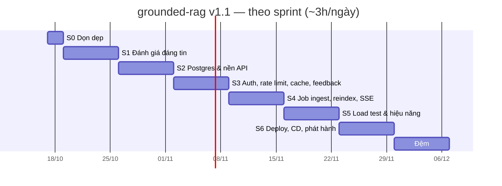

# 13 — Kế hoạch theo sprint tới `v1.1.0`

| | |
|---|---|
| Trạng thái | **Đề xuất** |
| Ngày lập | 2026-10-17 |
| Phạm vi | Toàn bộ việc của [12](12-assessment-and-plan.md) §10, chia thành task có ước lượng |
| Nhịp | Sprint 1 tuần (thứ Hai → Chủ nhật), ~3h/ngày ≈ **21h/sprint**; mỗi sprint lên kế hoạch ≤ 20h |
| Bắt đầu | Sprint 0: 2026-10-17 |
| Phát hành | `v1.1.0` cuối Sprint 6: **2026-11-29** |
| Hạn cứng | Hết sprint đệm: **2026-12-06** |

Ước lượng chi tiết cho thấy 4 tuần ở [12](12-assessment-and-plan.md) là không đủ:
riêng "Lõi backend" đã khoảng 37h, gần gấp đôi một sprint. Lịch dưới đây có
6 sprint việc và 1 sprint đệm, và **thay thế lịch trong 12**. Nội dung việc
không đổi.

Ước lượng giả định làm cả 7 ngày/tuần như [08](08-roadmap.md). Nếu chỉ làm
ngày thường, nhân thời lượng với 1,4 (phát hành khoảng giữa tháng 12).

---

## Tổng quan

| Sprint | Ngày | Mục tiêu sprint | Giờ | Lỗ hổng sửa ([12](12-assessment-and-plan.md) §1) |
|---|---|---|---|---|
| S0 | 17–18/10 | Cắt phần thừa, chốt tài liệu | 5 | — |
| S1 | 19–25/10 | Số liệu có nhãn người và khoảng tin cậy | 20 | L1 |
| S2 | 26/10–01/11 | Mọi câu trả lời được lưu và tra lại được | 19 | L3 |
| S3 | 02–08/11 | API có chủ, có giới hạn, có cache | 18 | L3 |
| S4 | 09–15/11 | Ingest bằng job nền, reindex không downtime | 20 | L3, B6 |
| S5 | 16–22/11 | Biết hệ thống bão hòa ở đâu | 18 | L4 |
| S6 | 23–29/11 | Demo public, CD, `v1.1.0` | 20 | L2 |
| Đệm | 30/11–06/12 | Trễ, sửa phát hiện, tùy chọn | — | — |

**Đường găng:** S2 → S3 → S4 → S6. S1 độc lập, nên nếu S1 trễ thì việc chấm
tay chạy song song với S2. S5 cần S3 (rate limit phải tắt được khi load test).

---

## Quy ước

- **ID** `S<sprint>-<số>`. Mỗi task là một commit hoặc một PR nhỏ, message một
  dòng tiếng Anh theo thể mệnh lệnh.
- **Xong khi** phải kiểm chứng được: một lệnh chạy ra kết quả, một test xanh,
  hoặc một file được commit. "Gần xong" không tính.
- **Mọi sprint kết thúc khi:** `make test` và `make lint` xanh, CI xanh trên
  GitHub, cập nhật trạng thái ở cuối file này (mục *Nhật ký sprint*).
- Task ghi **(cắt được)** là thứ bỏ đầu tiên khi sprint trễ.
- Thêm việc mới giữa sprint thì phải bỏ một việc có cùng số giờ ra khỏi sprint
  đó. Đối chiếu [12](12-assessment-and-plan.md) §9.4 trước khi thêm.

---

## Sprint 0 — Dọn dẹp (17–18/10, 5h)

**Mục tiêu:** repo chỉ còn những thứ sẽ bảo vệ được khi phỏng vấn.

| ID | Việc | Giờ | Xong khi |
|---|---|---|---|
| S0-01 | Commit tài liệu 12, 13 và đổi tên file `docs/` | 0.25 | `git log` có commit; link trong `docs/` không gãy |
| S0-02 | Xóa `app/streamlit_demo.py`, target `make demo`, extra `demo` trong `pyproject.toml`, dòng cuối mục Demo UI trong README | 1 | `grep -ri streamlit` chỉ còn trong tài liệu lịch sử ([08](08-roadmap.md)) |
| S0-03 | Đổi tên bước CI "Benchmark gate" thành "Pipeline smoke test (mock)" | 0.25 | CI xanh với tên mới |
| S0-04 | Cho `reports/hand-graded*.json` vào git (ngoại lệ trong `.gitignore`) | 0.25 | `git check-ignore reports/hand-graded.json` không trả gì |
| S0-05 | Langfuse: `make up`, chạy 3 câu, xem trace trên UI, chụp ảnh vào `docs/img/` | 2 | Ảnh có trong repo. **Nếu trace không hiện:** bỏ Langfuse khỏi dòng Stack của README, ghi vào Limitations |
| S0-06 | Rà dòng Stack trong README: chỉ ghi thứ đã chạy thật (RAGAS giữ tới S1-08 rồi xét lại) | 0.5 | Mỗi mục trong Stack có bằng chứng trong repo |
| S0-07 | Tạo milestone và issue trên GitHub từ các task S1–S6 **(cắt được)** | 0.75 | Mỗi sprint là một milestone |

---

## Sprint 1 — Đánh giá đáng tin (19–25/10, 20h)

**Mục tiêu:** README nói được guard có ích hay không, bằng nhãn người, kèm
khoảng tin cậy. Sửa L1 và E1–E4, E7 ([12](12-assessment-and-plan.md) §7.2).

| ID | Việc | Giờ | Phụ thuộc | Xong khi |
|---|---|---|---|---|
| S1-01 | `scripts/hand_grade.py sample`: ngoài 30 câu ngẫu nhiên, thêm **mọi** câu bị thước đo gắn cờ ở 4 report (cột `stratum`: `random` / `flagged`) | 1.5 | S0-04 | Sheet có 30 câu ngẫu nhiên + ~13 câu bị gắn cờ; test cho phần lấy mẫu |
| S1-02 | Chấm tay toàn bộ sheet, đối chiếu từng mệnh đề với khoản gold trong `data/corpus/` | 6 | S1-01 | Mọi `grade` có giá trị, `note` ghi lý do với câu `wrong` / `partly`; `score` chạy được; file được commit |
| S1-03 | `score` tách theo `stratum`: tỉ lệ NLI chấm oan, tỉ lệ NLI bỏ lọt | 1 | S1-02 | `reports/hand-graded.summary.json` có bảng 2×2 cho từng nhóm |
| S1-04 | Khoảng tin cậy bootstrap trong `eval/report.py`: lấy mẫu lại theo câu hỏi, 10.000 lần, seed cố định, cho mọi cột tỉ lệ | 3 | — | Bảng in `0.088 [0.03, 0.15]`; test với dữ liệu biết trước kết quả |
| S1-05 | So sánh cặp `baseline` ↔ `full` ↔ `agentic` bằng bootstrap cặp trên cùng câu hỏi **(cắt được)** | 2 | S1-04 | Một bảng: chênh lệch, CI của chênh lệch, có chứa 0 hay không |
| S1-06 | `answer_correctness` tự động: số trong `gold_answer` có mặt trong câu trả lời (dùng lại `numbers()` của `guard/nli_verifier.py`) | 2 | — | Cột mới trong `eval/metrics.py` + test; `eval.rejudge` tính lại được trên report cũ, không gọi LLM |
| S1-07 | `recall@k` (k = 1, 3, 5) và `MRR` trên thứ tự `sources` | 1.5 | — | Có trong `aggregate()` + test |
| S1-08 | LLM judge (`eval/ragas_eval.py`) trên đúng các câu đã chấm tay; giám khảo khác họ với generator. Chia nhiều ngày nếu free tier giới hạn request | 2 | S1-02 | Độ đồng thuận judge ↔ người trong summary; quyết định giữ hay bỏ RAGAS khỏi Stack |
| S1-09 | Cập nhật README: Results có CI và cột nhãn người, Limitations thêm E1, E5; bỏ "hallucination 0.000" khỏi vai trò số chủ đạo | 1 | S1-03, S1-04 | Mọi số trong README sinh lại được bằng một lệnh ghi bên cạnh |

**Demo cuối sprint:** `python -m eval.report reports/2026-10-12-gemini/*.json`
in bảng có khoảng tin cậy; `reports/hand-graded.summary.json` trả lời được câu
"bao nhiêu trong 7/80 câu baseline là bịa thật".

**Nếu kết quả xấu** (guard không hơn baseline theo nhãn người): viết ra đúng như
vậy. Không chỉnh số, không chỉnh nhãn ([07](07-evaluation-plan.md) — Kỷ luật).

---

## Sprint 2 — Postgres & nền API (26/10–01/11, 19h)

**Mục tiêu:** mọi câu trả lời đã phục vụ đều được lưu và tra lại được. API có
một dạng lỗi và một request-id xuyên suốt.

Quyết định thiết kế cần giữ: **DB là tùy chọn**. Khi `DATABASE_URL` trống,
không lưu gì và mọi thứ vẫn chạy như cũ. Quick start bằng `mock` (N5 trong
[02](02-requirements.md)) không được phải cài Postgres.

| ID | Việc | Giờ | Phụ thuộc | Xong khi |
|---|---|---|---|---|
| S2-01 | Thêm `sqlalchemy[asyncio]`, `asyncpg`, `alembic` (extra `db`); `DATABASE_URL` trong `config.py` và `.env.example`; service `db` (postgres:16, pin phiên bản) trong compose | 2 | — | `make up-db` chạy; `DATABASE_URL` trống thì app khởi động như cũ |
| S2-02 | Alembic + migration đầu: `requests` (câu hỏi, config, `as_of`, status, `abstain_reason`, latency, tokens, llm_calls, cost, `created_at`) và `claims` (text, citations, entailment, verdict, kept) | 4 | S2-01 | `alembic upgrade head` trên DB trống và `alembic downgrade base` đều chạy |
| S2-03 | Lớp repository + ghi mỗi `/chat` và `/chat/stream` vào DB. **Lỗi DB không làm hỏng câu trả lời**: ghi log, tăng một counter, vẫn trả lời | 3 | S2-02 | Test tích hợp: một `/chat` sinh đúng một dòng `requests` và N dòng `claims`; DB chết → vẫn 200 |
| S2-04 | `GET /v1/requests/{id}`; `meta.request_id` trong response | 1 | S2-03 | Lấy lại đúng câu trả lời đã phục vụ, kể cả mệnh đề bị bỏ |
| S2-05 | Đưa mọi route sang tiền tố `/v1` (giữ `/healthz`, `/metrics`, `/` ngoài); cập nhật `app/web/app.js`, `make seed`, README, test | 2 | — | Không còn gọi route cũ: `grep -rn '"/chat"'` chỉ còn trong test chuyển hướng |
| S2-06 | Lỗi theo `application/problem+json` (RFC 9457) cho `HTTPException`, lỗi validation, `LLMUnavailable` | 2 | S2-05 | Mọi 4xx/5xx có `type`, `title`, `status`, `detail`, `instance`; test cho từng loại |
| S2-07 | Middleware `X-Request-ID` (nhận từ client hoặc tự sinh) + log JSON một dòng mỗi request: id, route, config, status, latency, llm_calls | 2 | — | Một request truy được từ log → response → dòng DB bằng cùng một id |
| S2-08 | CI: job tích hợp có service container Postgres; test cần DB gắn marker `db`, unit test không cần DB | 2 | S2-03 | CI chạy cả hai job; `pytest -m "not db"` vẫn chạy được không có Postgres |
| S2-09 | Cập nhật [05](05-api-design.md) (route `/v1`, dạng lỗi) và [04](04-data-design.md) (schema DB) | 1 | S2-06 | Tài liệu khớp với code |

**Demo cuối sprint:** gửi một câu hỏi, lấy `request_id` trong response, gọi
`GET /v1/requests/{id}`, tìm đúng dòng log bằng id đó.

---

## Sprint 3 — Auth, rate limit, cache, feedback (02–08/11, 18h)

**Mục tiêu:** API có chủ, có giới hạn, rẻ khi câu hỏi lặp lại, và thu được phản
hồi của người dùng.

Chính sách truy cập cho demo public: `/v1/chat` cho phép **ẩn danh**, giới hạn
chặt theo IP. Có API key thì giới hạn rộng hơn. Route admin bắt buộc key có scope `admin`.

| ID | Việc | Giờ | Phụ thuộc | Xong khi |
|---|---|---|---|---|
| S3-01 | Migration `api_keys` (prefix, `sha256` của key, scopes, `revoked_at`, `last_used_at`); CLI `python -m grounded_rag.admin create-key --scope chat,admin` in key **một lần** | 3 | S2-02 | Key không bao giờ lưu dạng rõ; test tạo → dùng → thu hồi |
| S3-02 | Dependency `require_scope(...)` thay `ADMIN_API_KEY`; vẫn so sánh constant-time; giữ `ADMIN_API_KEY` làm đường dự phòng khi không có DB | 3 | S3-01 | Key sai → 401, sai scope → 403, bị thu hồi → 401; test cho cả ba |
| S3-03 | Rate limit token bucket trong tiến trình, theo key hoặc IP; 429 + `Retry-After` dạng problem+json; cấu hình tin `X-Forwarded-For` khi đứng sau proxy; tắt được bằng biến môi trường | 3 | S2-06 | Test vượt ngưỡng → 429; đồng hồ giả, không `sleep` trong test |
| S3-04 | Cache câu trả lời trong Postgres: khóa = hash(câu hỏi chuẩn hóa NFC + lowercase + gộp khoảng trắng, config, `as_of`, `index_version`). `index_version` tăng mỗi lần ingest | 3 | S2-02 | Câu lặp lại < 50 ms, `meta.cached: true`; ingest xong thì cache cũ không còn được dùng (test) |
| S3-05 | Migration `feedback` + `POST /v1/feedback`: `request_id`, chỉ số mệnh đề (tùy chọn), `rating` (`up` / `down` / `wrong`), ghi chú | 2 | S2-04 | Phản hồi cho `request_id` không tồn tại → 404; test |
| S3-06 | Nút 👍 / 👎 / "báo sai" cho từng mệnh đề trong `app/web/` | 2 | S3-05 | Bấm trên UI → có dòng trong `feedback` |
| S3-07 | `scripts/export_feedback.py`: phản hồi `wrong` / `down` → ứng viên `questions.candidates.jsonl` theo đúng định dạng LABELING.md, chờ người duyệt **(cắt được)** | 1 | S3-05 | File sinh ra qua được bước định dạng của `check_dataset.py` |
| S3-08 | ADR-0009 — rate limit trong tiến trình, một replica, khi nào phải chuyển sang Redis | 1 | S3-03 | ADR theo mẫu các ADR cũ, liệt kê phương án bị loại |

**Demo cuối sprint:** gọi `/v1/chat` liên tục không có key cho tới khi nhận
429; hỏi lại một câu cũ và thấy `cached: true`; báo sai một mệnh đề trên UI
và thấy dòng tương ứng trong DB.

---

## Sprint 4 — Job ingest, reindex, SSE tiến độ (09–15/11, 20h)

**Mục tiêu:** ingest sống qua restart; reindex không downtime và rollback được
(sửa B6); người dùng thấy hệ thống đang làm gì trong ~24 giây chờ.

Đã kiểm tra trước: Qdrant chạy ở chế độ `:memory:` hỗ trợ alias, nên test
không cần server Qdrant.

| ID | Việc | Giờ | Phụ thuộc | Xong khi |
|---|---|---|---|---|
| S4-01 | Migration `jobs` (kind, payload, status `queued` / `running` / `done` / `failed`, attempts, `locked_until`, progress, error); `POST /v1/ingest/jobs` → 202 + `Location`; `GET /v1/ingest/jobs/{id}` | 3 | S3-02 | Request trả ngay, không chờ embed; cần scope `admin` |
| S4-02 | Worker `python -m grounded_rag.worker`: nhận job bằng `SELECT … FOR UPDATE SKIP LOCKED`, gia hạn `locked_until` khi đang chạy, tối đa 3 lần thử, ghi `progress` theo số file | 4 | S4-01 | Worker chết giữa chừng → job được nhận lại sau khi hết hạn khóa |
| S4-03 | Test tích hợp: 2 worker, 10 job → mỗi job chạy đúng một lần; job lỗi → `failed` kèm lỗi, worker vẫn sống | 2 | S4-02 | Test xanh trong job CI có Postgres |
| S4-04 | Reindex qua collection có phiên bản: ingest đầy đủ ghi vào `grounded_rag_v<n>`, xong thì đổi alias `live` một lần (nguyên tử), giữ bản trước; truy vấn chỉ đọc `live`; `index_version` = `n` | 4 | S4-02 | `make reindex` và `make rollback` chạy được; `/v1/chat` không lỗi trong lúc đổi alias (test gửi request song song) |
| S4-05 | Test cho B6: sửa một khoản trong corpus tạm, reindex → văn bản cũ không còn được truy xuất | 1 | S4-04 | Test xanh; B6 trong [12](12-assessment-and-plan.md) §8 chuyển sang "Đã sửa" |
| S4-06 | SSE tiến độ: `service.answer_question` nhận callback sự kiện; `/v1/chat/stream` phát `retrieving` → `generating` → `verifying` → `claim` → `done`. Giữ [ADR-0003](adr/0003-verify-before-stream.md): không có `claim` nào trước khi kiểm chứng xong | 3 | S2-05 | Test thứ tự sự kiện; không có `claim` trước `verifying` |
| S4-07 | `app/web/app.js` chuyển từ `fetch("/chat")` sang đọc stream, hiện bước đang chạy | 1 | S4-06 | Trên UI thấy bước đang chạy đổi theo thời gian thật |
| S4-08 | ADR-0008 (Postgres làm hàng đợi) và ADR-0010 (reindex bằng alias) | 2 | S4-04 | Hai ADR theo mẫu cũ |

**Demo cuối sprint:** tạo job ingest, `kill` worker giữa chừng, khởi động lại
và thấy job chạy xong; reindex trong lúc một vòng lặp đang gọi `/v1/chat` mà
không có lỗi nào; rollback bằng một lệnh.

---

## Sprint 5 — Load test & hiệu năng (16–22/11, 18h)

**Mục tiêu:** biết hệ thống bão hòa ở đâu, bước nào nghẽn, và có một tối ưu
được đo trước/sau.

Vấn đề cần sửa trước: hiện `LLM_PROVIDER=mock` bật mock cho **mọi thứ**
(`store.py`, `embedder.py`, `reranker.py`, `nli_verifier.py`). Load test bằng
mock chỉ đo được chi phí của FastAPI, còn load test bằng LLM thật thì tốn quota.

| ID | Việc | Giờ | Phụ thuộc | Xong khi |
|---|---|---|---|---|
| S5-01 | Tách `MODEL_BACKEND=mock\|real` khỏi `LLM_PROVIDER`; thêm `LLM_MOCK_LATENCY_MS` cho mock LLM. Mặc định giữ nguyên hành vi cũ | 3 | — | Chạy được model thật + LLM giả có độ trễ; test hiện có không đổi |
| S5-02 | Kịch bản k6 trong `loadtest/`: trộn câu hỏi từ tập test, kèm một probe `/healthz` riêng; rate limit tắt qua biến môi trường | 3 | S3-03, S5-01 | `make loadtest VUS=5` chạy được và xuất JSON |
| S5-03 | Đo nền: 1 / 2 / 5 / 10 người dùng ảo, model thật trên CPU, LLM giả 1,5 s | 3 | S5-02 | Bảng throughput, p50 / p95 / p99, tỉ lệ lỗi, `/healthz` p99, phân rã theo bước từ `meta.steps` |
| S5-04 | Ablation chỉ cho retrieval, không gọi LLM (`scripts/retrieval_ablation.py`): `rerank_candidates` 20 / 12 / 8 → recall@k, thời gian rerank | 3 | S1-07 | Một bảng: giảm bao nhiêu giây, mất bao nhiêu recall |
| S5-05 | Áp dụng một tối ưu nếu đáng (ví dụ `rerank_candidates`, `MODEL_WORKERS=2`), chạy lại S5-03 | 2 | S5-03, S5-04 | Bảng trước/sau; nếu không tối ưu nào đáng thì ghi lý do |
| S5-06 | `/metrics` thêm counter: cache hit/miss, 429, lỗi ghi DB, độ dài hàng đợi job, độ sâu hàng đợi của pool model | 2 | S3-04, S4-02 | Thấy được trên `/metrics`; test |
| S5-07 | Mục "Hiệu năng" trong [09](09-runbook.md): cách chạy, bảng số, nghẽn ở đâu, scale thế nào nếu có GPU / nhiều máy | 2 | S5-05 | Trả lời được câu "chịu tải tới đâu" bằng số |

**Demo cuối sprint:** `make loadtest VUS=10` và đọc bảng: bão hòa ở bao nhiêu
request/giây, bước nào chiếm thời gian, `/healthz` còn nhanh không.

---

## Sprint 6 — Deploy, CD, phát hành (23–29/11, 20h)

**Mục tiêu:** một link bấm vào là hỏi được; push lên `master` là có bản mới; tag `v1.1.0`.

| ID | Việc | Giờ | Phụ thuộc | Xong khi |
|---|---|---|---|---|
| S6-01 | Chọn nền tảng: kiểm tra lại giới hạn gói free hiện tại (RAM ≥ 8 GB cho 3 model, ngủ khi không dùng, dung lượng ổ). Ứng viên: Hugging Face Spaces (Docker) | 1 | — | Quyết định ghi trong [09](09-runbook.md), kèm phương án dự phòng |
| S6-02 | Tạo Postgres managed + Qdrant Cloud gói free; `alembic upgrade head`; chạy job ingest lên bản deploy | 2 | S4-04 | Qdrant từ xa có alias `live` với đủ 2 luật |
| S6-03 | Đóng gói chạy được trên nền tảng: API và worker trong cùng container nếu nền tảng chỉ cho một tiến trình; cache model HF trên volume nếu có | 3 | S6-01 | Bản deploy trả lời được một câu hỏi thật |
| S6-04 | Workflow CD: khi CI xanh trên `master` → `alembic upgrade` → deploy → smoke test (`/healthz` + một `/v1/chat`) | 3 | S6-03 | Một push → bản mới chạy, không thao tác tay; smoke test lỗi thì workflow đỏ |
| S6-05 | Secret chỉ nằm ở biến môi trường của nền tảng; rate limit ẩn danh đủ chặt để không tiêu hết quota LLM trong một ngày | 1 | S3-03 | Kiểm tra: không có secret trong image hay trong log |
| S6-06 | README: 3 dòng tóm tắt, link demo, GIF, sơ đồ kiến trúc có DB và worker, bảng số từ S1, mục Hiệu năng từ S5 | 3 | S1-09, S5-07 | Người lạ hiểu dự án trong 2 phút (nhờ một người đọc thử) |
| S6-07 | Gộp [01](01-project-overview.md)–[05](05-api-design.md) thành một tài liệu kiến trúc ngắn, cập nhật mục lục **(cắt được)** | 3 | S2-09 | Không link nào trong `docs/` bị gãy |
| S6-08 | Video demo 90 giây **(cắt được)** | 2 | S6-04 | Link trong README |
| S6-09 | `CHANGELOG.md`, tag `v1.1.0`, đánh dấu xong trong [12](12-assessment-and-plan.md) §11 và [08](08-roadmap.md) | 1 | tất cả | Tag có trên GitHub, release note liệt kê các thay đổi |
| S6-10 | Cập nhật CV theo [12](12-assessment-and-plan.md) §14, chỉ những dòng đã xong | 1 | S6-09 | Mọi con số trên CV có trong repo |

**Demo cuối sprint:** gửi link cho một người chưa biết dự án; họ hỏi được một
câu, thấy mệnh đề được kiểm chứng, và hiểu vì sao hệ thống từ chối một câu ngoài phạm vi.

---

## Sprint đệm (30/11–06/12)

Dùng theo thứ tự:

1. Việc trễ từ S1–S6 (trừ task "cắt được").
2. Chạy lại eval nếu S5-05 đổi cấu hình truy xuất, cập nhật bảng số.
3. Tùy chọn: tách embed / rerank / NLI ra tiến trình riêng (WS5a của
   [11](11-spec-v2.md)), chạy lại load test để so.
4. Tùy chọn: luyện trả lời các câu ở [12](12-assessment-and-plan.md) §15 thành tiếng, mỗi câu dưới 2 phút.

---

## Quy tắc khi trễ

| Tình huống | Xử lý |
|---|---|
| Một sprint trễ ≤ 3h | Bỏ task "cắt được" của chính sprint đó |
| Một sprint trễ > 3h | Chuyển việc còn lại sang sprint đệm; không kéo dài sprint |
| Sprint đệm đã hết | Cắt theo thứ tự: S6-08 video → S6-07 gộp tài liệu → S3-07 xuất feedback → S1-05 so sánh cặp → S3-06 nút feedback (giữ endpoint) |
| **Không bao giờ cắt** | S1-02 chấm tay, S2-02/S2-03 Postgres, S4-02 worker, S4-04 reindex, S6-03/S6-04 deploy + CD |

---

## Rủi ro theo sprint

| Sprint | Rủi ro | Dấu hiệu sớm | Xử lý |
|---|---|---|---|
| S1 | Chấm tay lâu hơn 6h | Hết ngày 2 mới xong < 15 câu | Giữ đủ các câu bị gắn cờ, giảm phần ngẫu nhiên xuống 20 câu, ghi rõ n |
| S1 | Free tier của giám khảo chặn request | 429 từ provider | Chia nhiều ngày (`--limit`), hoặc dùng giám khảo mở qua Ollama khác họ với generator |
| S2 | Lỗi event loop khi test async với asyncpg | Test treo hoặc lỗi "attached to a different loop" | Một engine cho mỗi event loop của test; fixture theo phiên |
| S4 | Đổi alias khi đang tải gây lỗi | S4-04 test song song đỏ | Đọc tên collection thật một lần mỗi request, không đọc lại giữa chừng |
| S5 | CPU laptop cho số không ổn định | Hai lần chạy chênh > 20% | Chạy 3 lần, báo trung vị; ghi cấu hình máy |
| S6 | Gói free không đủ RAM | Container bị kill khi nạp model | Tắt reranker ở bản demo (cấu hình riêng, ghi rõ trong README), hoặc nền tảng trả phí nhỏ nhất |

---

## Nhật ký sprint

Cập nhật vào ngày cuối mỗi sprint: xong gì, trễ gì, chuyển gì, phát hiện gì.

| Sprint | Kết quả | Chuyển sang sau | Ghi chú |
|---|---|---|---|
| S0 | Xong 7/7 ngày 25/10 (trễ 7 ngày); CI xanh | — | Langfuse chưa từng đẩy được trace: `.venv` có SDK 4.15 lệch khai báo v2, lỗi bị export best effort nuốt. Cài lại SDK v2, sửa compose chờ Postgres healthy, có ảnh trace thật. Stack bỏ vLLM (chưa chạy thật), RAGAS ghi rõ là chưa chạy. 51 issue trong 6 milestone |
| S1 | | | |
| S2 | | | |
| S3 | | | |
| S4 | | | |
| S5 | | | |
| S6 | | | |

---

[← 12 — Đánh giá & kế hoạch](12-assessment-and-plan.md) · [Mục lục tài liệu](README.md)
