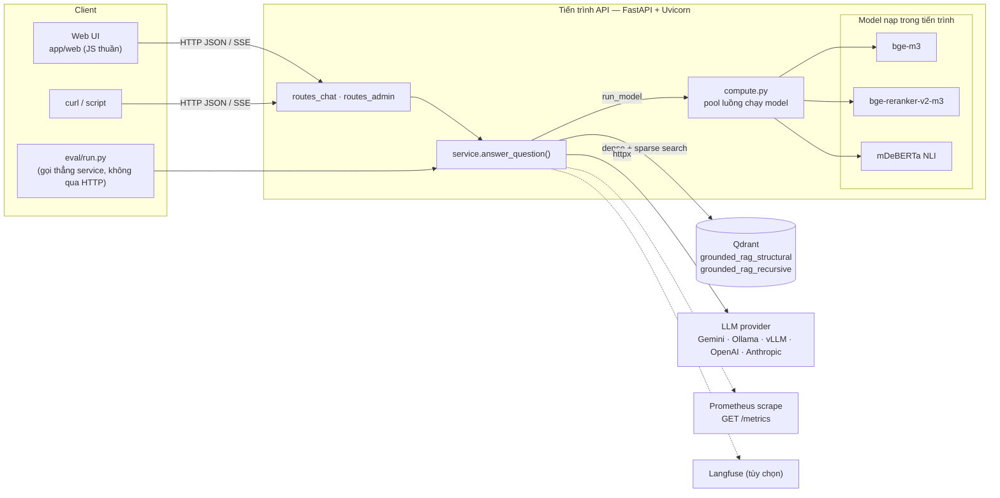

# 03 — Kiến trúc

## Toàn cảnh



Hiện tại hệ thống là **một tiến trình**: API, ba model và pipeline cùng chạy
trong Uvicorn. Không có database, không có hàng đợi. Qdrant và LLM provider là
hai phụ thuộc bên ngoài duy nhất (ở chế độ `mock` thì không cần cả hai).

## Hai luồng

### Offline — ingest

```
data/corpus/*.md|pdf
   │  ingest/loaders.py         đọc file, tách front matter YAML → DocMeta
   ▼
Document(doc_id, text, meta)
   │  ingest/chunkers.py        recursive (cửa sổ 1200 ký tự) | structural (Điều/Khoản)
   ▼
list[Chunk]                     chunk_id = doc_id + sha256(text)[:16]; mang effective/expiry date
   │  retrieval/store.py        upsert: bỏ chunk đã có, embed chunk mới (bge-m3), tính BM25
   ▼
Qdrant collection "grounded_rag_<chunker>"   point id = uuid5(chunk_id)
```

Kích hoạt bằng CLI `python -m grounded_rag.ingest.pipeline` (`make ingest`) hoặc
`POST /ingest` (cần `ADMIN_API_KEY`). Chi tiết: [06](06-ingest-and-retrieval.md).

### Online — một câu hỏi

```
question, config, as_of
   │  retrieval/corrective.py::retrieve
   │     search(): dense + BM25 → RRF → cắt 20 → rerank → top 5 (điểm 0–1)
   │     [agentic] điểm cao nhất < 0.60 → planner (1 LLM call) → tìm lại → gộp round-robin
   │     floor: bỏ chunk < min_score
   ├── out_of_domain ─────────────────────────────► no_context (out_of_domain)
   ├── không còn chunk ───────────────────────────► no_context (retrieval_floor)
   ▼
sources C1..C5 → generation/prompts.py → MeteredLLM.complete()
   │  generation/citation.py    gỡ mã trích dẫn không tồn tại
   ├── đúng câu từ chối ───────────────────────────► abstained (model | guard)
   ▼
[guard tắt] split_claims → answered (verdict = null)
[guard bật] guard/policy.py::verify_claims (NLI, luật con số, sửa trích dẫn)
   │  còn mệnh đề sai và còn lượt → sinh lại kèm phản hồi
   ▼
guard/policy.py::apply_policy → answered | partial | abstained (guard)
   ▼
Answer + meta (latency, tokens, llm_calls, cost, steps) → Prometheus, Langfuse
```

Chi tiết từng bước: [05](05-query-pipeline.md).

## Phân lớp module

```
api/            HTTP: route, schema, auth admin, phục vụ UI
  │
service.py      điều phối pipeline online (đọc file này đầu tiên)
  │
  ├── retrieval/   corrective (vòng lặp) → store, hybrid, lexical, reranker, embedder
  ├── generation/  llm_client (provider, ngân sách), prompts, citation
  ├── guard/       claim_splitter, nli_verifier, policy
  └── observability/ tracing (span, Langfuse), metrics (Prometheus)
  │
ingest/         offline: loaders → chunkers → pipeline (gọi retrieval/store)
compute.py      pool luồng cho mọi lời gọi model CPU
config.py       Settings (env) + RunConfig (YAML)
types.py        kiểu domain dùng chung: Chunk, Claim, Answer, …
```

Quy tắc phụ thuộc:

- `types.py` và `config.py` không import gì trong package (trừ nhau) → ai cũng
  import được.
- `api/` chỉ gọi `service.answer_question`, `ingest.pipeline.ingest` và
  `RunConfig`. Không có logic nghiệp vụ trong route.
- `eval/` (ngoài `src/`) import package như một thư viện: dùng lại
  `answer_question`, `split_claims`, `structural_chunk`, verifier… để chấm.
- `guard/` không biết gì về retrieval; nó nhận `list[RetrievedChunk]`.

## Hai lớp cấu hình

| Lớp | Nguồn | Chứa | Vì sao tách |
|---|---|---|---|
| `Settings` | biến môi trường / `.env` (không commit) | Provider, key, URL, tên model, số worker, key admin | Bí mật và hạ tầng, khác nhau giữa các máy |
| `RunConfig` | `configs/*.yaml` (commit) | Hành vi pipeline: chunker, top-k, floor, guard, τ, corrective, ngân sách LLM | Một lượt eval tái lập được chỉ từ repo |

Một request chọn `RunConfig` theo tên (`"config": "full"`), nên **bốn cấu hình
cùng chạy trên một server**. Chi tiết: [10](10-configuration-and-operations.md).

## Singleton và chế độ mock

Mọi thành phần nặng được tạo qua một hàm factory có cache, và factory đó chọn
bản thật hay bản giả theo **`settings.llm_provider == "mock"`**:

| Factory | Bản thật | Bản mock | Cache |
|---|---|---|---|
| `retrieval/embedder.py::get_embedder` | `BGEEmbedder` | `HashEmbedder` (sha256 → vector) | `lru_cache(1)` |
| `retrieval/reranker.py::get_reranker` | `BGEReranker` | `LexicalReranker` (tỉ lệ token trùng, thang 0–1) | `lru_cache(1)` |
| `retrieval/store.py::get_store(chunker)` | `QdrantStore("grounded_rag_<chunker>")` | `InMemoryStore` (cosine + BM25 Python) | `functools.cache`, một store mỗi chunker |
| `guard/nli_verifier.py::get_verifier` | `NLIVerifier` | `MockVerifier` (tỉ lệ token trùng) | `lru_cache(1)` |
| `generation/llm_client.py::get_llm_client` | theo provider | `MockClient` | `lru_cache(1)` |
| `compute.py::_pool` | `_OldestFirstPool(MODEL_WORKERS)` | như nhau | `lru_cache(1)` |

Hệ quả cần nhớ:

- `LLM_PROVIDER=mock` bật mock cho **mọi thứ**, không chỉ LLM. Đây là điều khiến
  test và CI chạy không cần key, không tải model, không cần mạng.
- Store mock nằm trong bộ nhớ của **một tiến trình**: ingest ở tiến trình khác
  không thấy được. Vì vậy `make seed` phải gọi `POST /ingest` vào server đang
  chạy, và `eval.run` có cờ `--ingest`.
- Model được nạp **lười** (lần gọi đầu tiên), nên import module không kéo
  checkpoint vài GB; câu hỏi đầu tiên chậm hơn hẳn.

## Mô hình đồng thời

Handler là `async def`, còn embed/rerank/NLI là lời gọi torch **đồng bộ** mất cả
giây. Gọi thẳng trong handler sẽ khóa event loop (từng là lỗi B1). Cách xử lý ở
`compute.py`:

```
request A ─ mark_arrival(t=0.0) ─┐
request B ─ mark_arrival(t=0.1) ─┼─► run_model(fn) ─► PriorityQueue[(arrival, seq, fn)]
request C ─ mark_arrival(t=0.2) ─┘                         │
                                                  MODEL_WORKERS luồng (mặc định 1)
                                                           │
                                       asyncio.wrap_future ◄┘  (event loop vẫn rảnh)
```

- **Ưu tiên theo thời điểm request đến**, không phải FIFO theo lời gọi: một
  request gọi model nhiều lần (rerank, rồi NLI), xen giữa là lời gọi LLM. Với
  FIFO, lượt NLI của request đầu phải xếp sau rerank của mọi request đến sau.
  Docstring trong `compute.py` ghi số đo mô phỏng: 5 request đồng thời, độ trễ
  trung bình 6,5 s (FIFO) → 5,0 s (oldest-first).
- `MODEL_WORKERS=1` là đúng trên CPU vì mỗi lời gọi torch đã dùng mọi lõi.
- `contextvars.copy_context()` được chuyển vào luồng worker để span tracing vẫn
  thuộc đúng request.
- Request bị hủy (client ngắt) thì lời gọi đang chờ bị bỏ qua
  (`set_running_or_notify_cancel`).
- `tests/test_concurrency.py` chứng minh `/healthz` vẫn trả lời ngay khi ba
  `/chat` đang chờ reranker chậm.

Đây là giải pháp tạm: khi model chuyển ra tiến trình riêng (WS5 trong
[../11-spec-v2.md](../11-spec-v2.md)) thì phần này thành I/O async thường.

## Vòng đời dữ liệu và trạng thái

| Dữ liệu | Ở đâu | Ai ghi | Tồn tại qua restart? |
|---|---|---|---|
| Corpus | `data/corpus/` (commit) | `scripts/prepare_corpus.py` | Có |
| Chỉ mục | Qdrant (`./qdrant_storage`) hoặc bộ nhớ (mock) | ingest | Qdrant: có · mock: **không** |
| Cấu hình chạy | `configs/*.yaml` | người | Có |
| Cache NLI | bộ nhớ tiến trình (LRU 4096 cặp) | `NLIVerifier` | Không |
| Câu trả lời | **không lưu** (chỉ log, Prometheus, Langfuse) | — | — |
| Kết quả eval | `reports/*.json` | `eval/*` | Có (một phần được commit) |

Đường online **không bao giờ ghi vào chỉ mục**: không có vòng phản hồi tự động
từ câu trả lời về corpus, vì như thế một lần bịa sẽ thành nguồn cho lần sau.

## Xử lý lỗi — nguyên tắc

| Tình huống | Kết quả | Vì sao |
|---|---|---|
| Hệ thống từ chối trả lời | **200**, `status: abstained / no_context` | Từ chối là kết quả hợp lệ, không phải lỗi |
| Provider LLM không phản hồi sau khi thử lại | **503** (`LLMUnavailable`) | Lỗi hạ tầng thật |
| Provider lỗi giữa SSE | sự kiện `event: error` | Header đã gửi, không đổi được mã |
| Planner trả JSON hỏng | coi như "không có truy vấn mới" | Lần truy xuất đầu vẫn còn để trả lời |
| Langfuse lỗi | ghi warning, bỏ qua | Tracing không được làm hỏng câu trả lời |
| Vượt `max_llm_calls` | `BudgetExceeded` (lẽ ra không bao giờ xảy ra) | Vòng lặp kiểm tra ngân sách trước khi gọi |

---

[← 02 — Tech stack](02-tech-stack.md) · [Handbook](README.md) · [04 — Đọc code →](04-code-reading-guide.md)
